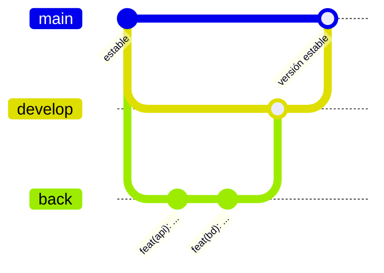

# Control de versiones

Usamos **commits convencionales en español**:

```
tipo(ámbito): descripción en presente, sin punto final
```

Ejemplo: `feat(juego): agrega pantalla de selección de nivel`

## Tipos

| Tipo | Cuándo | Ejemplo |
| --- | --- | --- |
| `feat` | Funcionalidad nueva visible para alguien (jugador, front, API) | `feat(api): agrega endpoint de fichas por idioma` |
| `fix` | Corrección de un error | `fix(importador): descarta −999 como temperatura real` |
| `docs` | Solo documentación | `docs(bd): documenta el diagrama entidad-relación` |
| `refactor` | Cambia el código sin cambiar su comportamiento | `refactor(api): separa repositorio y servicio de escenarios` |
| `test` | Añade o ajusta pruebas | `test(api): cubre 404 de escenario inexistente` |
| `chore` | Mantenimiento: dependencias, configuración, scripts | `chore(infra): fija postgres 17 en docker compose` |

## Ámbito (obligatorio)

Una palabra en minúsculas que diga **dónde** cae el cambio. Sugeridos (no es lista cerrada):
`juego`, `front`, `api`, `bd`, `importador`, `datos`, `contrato`, `docs`, `infra`.

## Reglas del encabezado

- Máximo 72 caracteres, sin punto final, verbo en presente (*agrega*, *corrige*, *elimina*).
- Describe el **qué**; el **porqué** va en el cuerpo del commit si no es obvio.
- Cambio incompatible con el contrato de la API: añade `!` → `feat(api)!: renombra factIds a facts`.
- Un commit = un cambio coherente. No mezclar `docs` con `feat` si se pueden separar.

## Validación automática

`pnpm install` activa un hook (`.githooks/commit-msg`) que rechaza mensajes con otro formato. Si el hook no está activo:

```bash
pnpm prepare
```

El hook valida con [scripts/validar-commit.mjs](scripts/validar-commit.mjs) solo el primer renglón; `Merge …` y `Revert …` pasan sin validar.

## Ramas y flujo

Solo hay tres ramas. Las subramas existen para **aislar el trabajo del back**, no para multiplicarse por tarea.

| Rama | Para qué |
| --- | --- |
| `main` | Solo código **estable**. Sin commits directos |
| `develop` | Integración: reúne lo que ya funciona mientras se estabiliza |
| `back` | Subrama de `develop` con todo el trabajo del backend (API, BD, importador). El front vive aparte y se integra a `develop` por su cuenta |

- `back` → `develop`: Pull Request, con `pnpm test` en verde.
- `develop` → `main`: cuando todo esté estable (pruebas en verde, migraciones aplicables desde cero, documentación al día).
- Si más adelante el front necesita aislarse igual, se crea `front` con el mismo esquema.



- Los cambios al contrato ([contrato/scenario.schema.json](contrato/scenario.schema.json)) o al esquema de BD se avisan a los roles 1 y 2 antes de fusionar.

## Documentación en dos idiomas

La documentación técnica está en español (`docs/`) y en inglés (`docs/en/`, más `README.en.md`). Un cambio de documentación toca ambas versiones en el mismo commit. Los mensajes de commit siguen en español.

## Qué nunca se sube

`.env`, credenciales, los ZIP de muestras y los originales de datos (se conservan fuera del repo, identificados por SHA-256). Ver [.gitignore](.gitignore).
