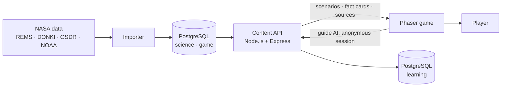

# JIIMATZIN — Junior Astronaut Mission Trainer

> English version of [README.md](README.md). The Spanish files are the reference; update both in the same commit.

A 2D web adventure for children aged 7 to 12. Over ten sols (Martian days) the player runs a base on Mars: shares out power, looks after oxygen and shielding, plays minigames and decides how to respond to emergencies. Every decision has a cost, and each night the game explains why with **real data from NASA missions**.

Built for NASA Space Apps Challenge 2026 · *Build a Junior Astronaut Mission Trainer*.

## How it works



- **Scenarios:** environmental conditions and real events (space weather, temperature and pressure on Mars) selected for each sol of the game.
- **"Real data" cards:** child-friendly explanations backed by evidence, with the source in plain sight.
- **Provenance:** every datum keeps its origin, date and quality; missing values are never turned into measurements.
- **Guide AI:** estimates how well the child has mastered four topics (Bayesian Knowledge Tracing), adapts the help it gives and stores each game anonymously so the team can study how children learn with it.
- **Historical mode:** the game presents data from dated captures and says so explicitly.

## Structure

```
jiimatzin/
├── backend/          content API (Node.js, Express 5, PostgreSQL)
│   ├── migrations/   versioned schema (6 migrations)
│   └── src/
│       ├── escenarios/        missions and conditions (scenarios)
│       ├── fichas/            "Real data" fact cards and their evidence
│       ├── fuentes/           provenance and attribution (sources)
│       ├── donki/             near-real-time solar flares
│       ├── partidas/          anonymous game sessions (the only write)
│       ├── salud/             service health
│       ├── importador/        scientific package import
│       ├── contenido/         game catalogue import
│       ├── publicaciones/     validate, publish and retire scientific content
│       ├── compartido/        application errors
│       └── infraestructura/   configuration, database and middleware
├── frontend/         Phaser game, guide AI and API adapter
├── contrato/         JSON Schemas shared by back end and front end
├── docs/             technical documentation with diagrams (Spanish) — English in docs/en/
└── scripts/          commit and package-manager checks
```

Each back-end feature gathers its model, JSON view, controller, routes and repository. Folder and file names are in Spanish (screaming architecture); see [docs/en/02-architecture.md](docs/en/02-architecture.md) and [backend/README.md](backend/README.md).

## Where it is published

| Site | URL | What it includes |
| --- | --- | --- |
| Google Cloud (main) | <https://project-dd0f486a-7a8b-44de-86e.web.app> | Game on Firebase Hosting, API on Cloud Run and PostgreSQL on Cloud SQL, under the same domain (`/api/**` and `/health` go to the API). Stores the anonymous sessions |
| GitHub Pages | <https://as9689138.github.io/juniorAstronautMissionTrainer_JIIMATZIN/> | Only the static game, with no API: it uses the fallback in `public/escenarios/` and its local session queue reaches no server unless it is built with `VITE_API_URL` |

Checked on 2026-11-15: `/health` and `/health/listo` answer `ok` on the cloud site and `/api/v1/scenarios` lists `base-marte-uno` v1, published with real data (science package `3fe144ab…28f67`, 263,358 REMS observations). Checked in the browser: the game on the Google Cloud site loads the scenario from the API (`/api/v1/scenarios/base-marte-uno`, 200; the console logs `escenario "Base Marte Uno…" v1 (api)`, not the fallback) and queries live DONKI.

## Getting started

Requirements: Node ≥ 22.9, pnpm (`corepack enable`) and Docker (or a local PostgreSQL).

```bash
cp .env.example .env
pnpm install
pnpm db:up
pnpm migrar
pnpm dev:back
```

Check: <http://localhost:3000/health> and <http://localhost:3000/api/v1/scenarios>.

| Command | What it does |
| --- | --- |
| `pnpm dev:back` | API with automatic reload (port 3000) |
| `pnpm dev:front` | Front-end development server |
| `pnpm db:up` / `db:down` | Start / stop PostgreSQL 17 in Docker (port 5433) |
| `pnpm migrar` / `migrar:revertir` | Apply / revert migrations |
| `pnpm test` | Back-end tests (no PostgreSQL needed) |
| `pnpm test:integracion` | Tests against a temporary PostgreSQL |

With your own PostgreSQL: point `DATABASE_URL` in `.env` to your instance, skip `pnpm db:up` and run `pnpm migrar`.

## API

| Route | Response |
| --- | --- |
| `GET /health` · `GET /health/listo` | Service and database status |
| `GET /api/v1/scenarios` | Published scenarios |
| `GET /api/v1/scenarios/{id}?version=` | Full scenario with conditions and fact cards |
| `GET /api/v1/facts/{id}?lang=` | Fact card with evidence and references |
| `GET /api/v1/sources/{id}` | Attribution and context of a source |
| `GET /api/v1/live/donki/flares` | Recent solar flares (live DONKI) |
| `POST /api/v1/partidas` | Saves an anonymous game session (the only write) |

Format and errors: [docs/en/04-api.md](docs/en/04-api.md).

## Quality and production

- A read API with a single write (`POST /api/v1/partidas`: anonymous, strictly validated and capped at 64 KB), parameterised SQL, `helmet`, closed CORS, rate limiting and controlled caching.
- In production all configuration arrives through environment variables and the API refuses to start with insecure values. See [docs/en/06-production.md](docs/en/06-production.md).
- Automated tests of routes, validation, errors and configuration (58 without a database, plus the integration suites).

## Roadmap

1. **Database and importers:** done. `ciencia` (science), `juego` (game) and `aprendizaje` (learning) schemas, idempotent loads and publication controls. See [science import](docs/en/05-import.md) and [game content](docs/en/12-game-content.md).
2. **Scenarios:** done. Endpoints connected to `ciencia` through `juego`, contract 2, rule versions, pinned catalogue and static fallback. Publishing the mission and its editorial parameters is managed from the CLI.
3. **Game integration:** done. The Phaser game loads the scenario from the API (with fallback), shows the "Real data" cards and live DONKI flares, and saves anonymous sessions. See [front-end architecture](docs/en/15-frontend.md).
4. **Deployment:** done. The complete game with its API lives on Google Cloud (https://project-dd0f486a-7a8b-44de-86e.web.app: Firebase Hosting, Cloud Run and Cloud SQL, see [docs/en/07-google-cloud.md](docs/en/07-google-cloud.md)) and a static copy is published on GitHub Pages with every push to `main` (https://as9689138.github.io/juniorAstronautMissionTrainer_JIIMATZIN/). See [Where it is published](#where-it-is-published).
5. **Pending:** have native speakers review the English texts, schedule the deletion of sessions older than 12 months (policy already decided) and define the database backups. The first scenario with real data (`base-marte-uno` v1) is already published in the cloud.

## Documentation and collaboration

- Technical index: [docs/en/README.md](docs/en/README.md) (Spanish: [docs/README.md](docs/README.md))
- Commit and branch convention: [CONTRIBUTING.md](CONTRIBUTING.md) (in Spanish; commit messages are written in Spanish)
- Only **pnpm** is used: installation stops with npm or yarn.
