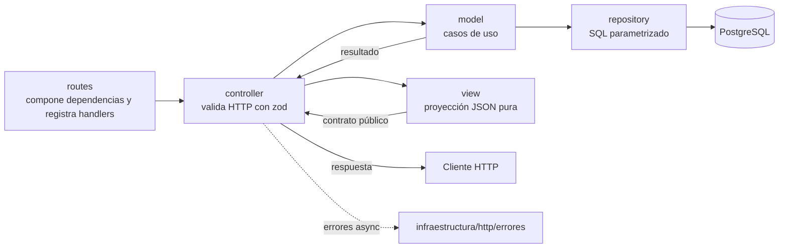
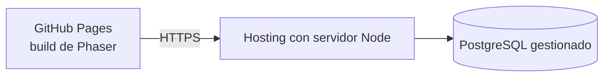

# Arquitectura

## Componentes y responsabilidades

El panorama completo (entradas administrativas, comandos, esquemas, API y frontend) está en el [diagrama 1](14-flujos-backend.md#1-panorama-del-sistema).

| Componente | Responsable propuesto (doc 04) |
| --- | --- |
| Importación, BD, endpoints de contenido | Rol 3 |
| Adaptador HTTP y carga en Phaser | Rol 1 |
| Reglas, efectos y balance | Rol 2 |
| Texto de historia y etiquetas | Rol 5, con revisión científica del rol 3 |

Principios: el frontend **nunca** se conecta a la BD; el backend **no** consulta NASA por jugador; la lógica de recursos del juego queda en el módulo de mecánicas, no en la API.

## Carga de un escenario

La consulta del escenario en la API y su carga en el frontend, con respaldo estático, están en los diagramas [8](14-flujos-backend.md#8-consulta-de-un-escenario) y [11](14-flujos-backend.md#11-carga-del-escenario-en-el-frontend).

## Estructura interna del backend

Se aplica **screaming architecture con MVC por funcionalidad**. Al abrir `backend/src/` se encuentran `escenarios/`, `fichas/`, `fuentes/`, `salud/` e `importador/`. Las carpetas expresan qué hace la API; cada recurso HTTP contiene su modelo, vista, controlador, rutas y repositorio.

### MVC en esta API

- **Modelo:** coordina las consultas y resuelve los casos de uso. La selección de escenarios publicados y fichas aprobadas se conserva en el SQL de sus repositorios. El modelo recibe el repositorio por inyección y desconoce Express, los estados HTTP y las variables de entorno.
- **Vista:** transforma datos internos al JSON del contrato (nombres públicos, versiones, condiciones, fichas y evidencia). No recibe `req`/`res` ni consulta PostgreSQL.
- **Controlador:** valida parámetros y consultas, llama al modelo y envía el resultado de la vista con el estado HTTP correspondiente. Express 5 propaga los errores asíncronos al middleware común.
- **Rutas:** componen las dependencias locales y conectan URL → controlador; no contienen SQL, validación ni construcción de respuestas.

`app.js` conecta configuración, middlewares y routers; `rutas.js` agrupa `/api/v1`. `infraestructura/` concentra configuración, pool y middlewares HTTP. `compartido/errores.js` define errores de aplicación sin dependencias de transporte; el middleware traduce una ausencia a 404 y oculta los errores inesperados con 500.

Los importadores científicos (`src/importador/`) y del desglose del juego
(`src/contenido/`) son comandos administrativos implementados. Validan entradas,
cargan en transacciones y conservan identidades por contenido. No exponen rutas
de escritura. Los escenarios fijan las revisiones de ambas partes y su vista
construye la respuesta pública; ver [catálogos](12-contenido-juego.md).

### Reglas para extender

1. Crear una carpeta con el nombre de la funcionalidad y mantener juntos sus archivos `*.model.js`, `*.view.js`, `*.controller.js`, `*.repository.js` y `*.routes.js`.
2. Mantener el SQL en repositorios y el formato público en vistas. Pasar las dependencias por las fábricas existentes.
3. Montar las rutas de contenido en `backend/src/rutas.js` y agregar pruebas HTTP con respuestas representativas y errores.
4. Actualizar la documentación; si cambia el contrato público, acordarlo con los roles 1 y 2 y actualizar schema/adaptador.

Este refactor conserva los endpoints, el esquema de PostgreSQL y el contrato del frontend. La separación se comprueba con pruebas HTTP y pool simulado; no implica haber importado datos reales ni haber aprobado el contrato borrador.

## Conexión front ↔ back

| Entorno | Cómo se conectan |
| --- | --- |
| Desarrollo | Vite (5173) con proxy `/api` → `localhost:3000`; sin CORS |
| Producción, mismo dominio | Proxy inverso: `/api` hacia la API |
| Producción, dominios distintos | `VITE_API_URL` apunta a la API y `CORS_ORIGINS` incluye el origen del front |

## Despliegue (sin confirmar)

GitHub Pages solo sirve estáticos: los endpoints dinámicos necesitan un host con ejecución de servidor y acceso a PostgreSQL. Ningún proveedor está elegido. Requisitos: `DATABASE_URL` solo en servidor, lista de orígenes CORS, copias de seguridad.
