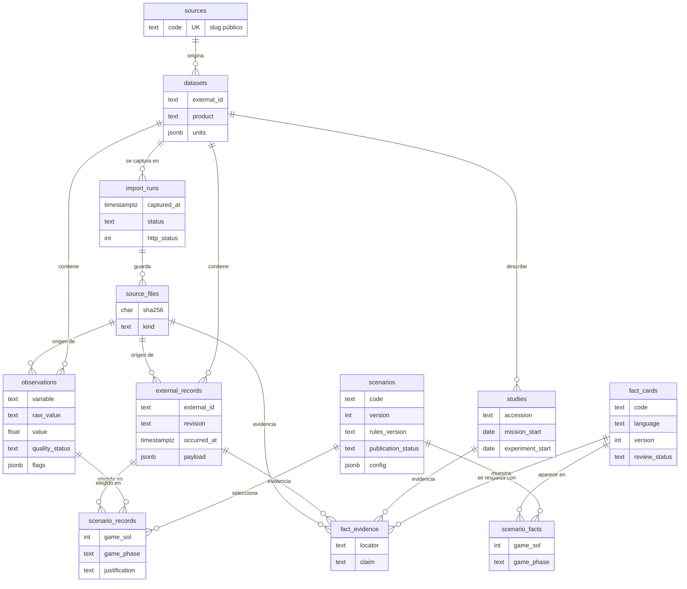

# Modelo de datos

El modelo descrito aquí corresponde al esquema inicial `public`. El paquete
estandarizado ajustado se modela en el nuevo esquema `ciencia`, con 28 tablas
(26 científicas y 2 de publicación):
ver el [diccionario](10-diccionario-bd.md) y el
[diagrama ER](11-diagrama-er.md). Los endpoints de fuentes y fichas
ya consultan `ciencia`; escenarios usa `juego` y las membresías científicas.
El importador y el vínculo escenario-publicación están implementados;
el esquema `juego` tiene 19 tablas: cinco de escenarios y catorce de catálogos
y vínculos. El desglose del juego se carga por versión, separado de ciencia;
ver [contenido](12-contenido-juego.md) y [modelo de juego](13-modelo-juego.md).
Un cuarto esquema, `aprendizaje` (2 tablas), guarda las partidas anónimas del juego y
sus pruebas de aprendizaje; ver [16-aprendizaje-partidas.md](16-aprendizaje-partidas.md).
Ver [API](04-api.md) e [importación](05-importacion.md).

| Esquema | Tablas | Quién escribe | Documento |
| --- | --- | --- | --- |
| `public` | esquema inicial (ya no se sirve) | migración inicial | este documento |
| `ciencia` | 28 (26 científicas y 2 de publicación) | importador y publicaciones (CLI) | [10](10-diccionario-bd.md), [11](11-diagrama-er.md) |
| `juego` | 19 (5 de escenarios y 14 de catálogos) | contenido y escenarios (CLI) | [12](12-contenido-juego.md), [13](13-modelo-juego.md) |
| `aprendizaje` | 2 (`partidas`, `pruebas`) | `POST /api/v1/partidas` | [16](16-aprendizaje-partidas.md) |

Implementado en [backend/migrations/20261114000000_esquema-inicial.sql](../backend/migrations/20261114000000_esquema-inicial.sql). Es el esquema propuesto en el doc 04, **todavía sujeto a aprobación**.

## Reglas incorporadas en el esquema

| Regla (origen) | Cómo se aplica |
| --- | --- |
| Cada evidencia apunta a **una** referencia válida (doc 04 §5) | `CHECK num_nonnulls(study_id, external_record_id, source_file_id) = 1` |
| Un registro de escenario es observación **o** registro externo | `CHECK num_nonnulls(observation_id, external_record_id) = 1` |
| −999 no es temperatura (doc 04 §6) | `raw_value` conserva el original; `value` es `NULL` y `quality_status = 'missing'` |
| Transporte ≠ experimento en OSDR (doc 03 §5) | `mission_start/end` separado de `experiment_start/end` (nulo si no establecido) |
| Fecha del fenómeno ≠ captura ≠ sol del juego (doc 04 §7) | `occurred_at`/`observed_at`, `import_runs.captured_at`, `game_sol` en columnas distintas |
| Reimportar no duplica (doc 04 §6) | `UNIQUE (uri, sha256)`, `(dataset_id, external_id, revision)`, `(source_file_id, record_index, variable)` |
| Una revisión usada no se borra (doc 04 §5) | FKs `RESTRICT` por defecto; solo se borran en cascada hijos del propio escenario/ficha |
| Errores 404/500 no son datos (doc 04 §6) | `import_runs.status = 'failed'` + `http_status`; sin filas en `observations` |
| Interpretación ≠ medición (doc 03 §5) | Texto editorial solo en `fact_cards` con `review_status`; la API publica únicamente `approved` |
| Escenario publicado fija versiones | `scenario_facts` apunta a una fila concreta de `fact_cards` (código + versión) |

## Observaciones de diseño

- `public.fact_cards.code` identifica las fichas del escenario inicial. El nuevo
  `GET /facts/{id}` busca por `ciencia.fact_cards.fact_key`; ambos catálogos
  requieren una correspondencia editorial explícita.
- `mission_sol` es el sol de Curiosity; `game_sol` es el día de la misión ficticia (1 a 10). No confundirlos.
- JSONB conserva el payload pero no sustituye al archivo original: el hash vive en `source_files`.
- Pendiente de decidir: tabla editorial para `uso_candidato`/`limite` de OSDR (doc 03 §8) y política de calidad REMS.
