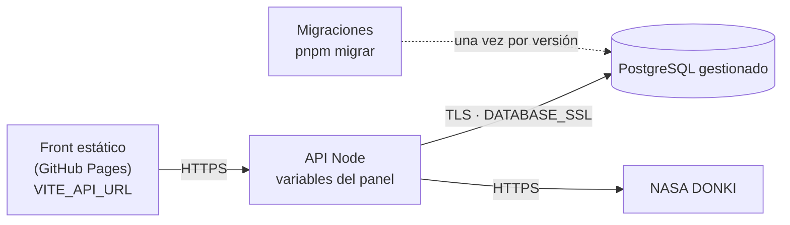

# Producción

El backend se despliega configurado **solo por variables de entorno**, definidas en el panel del hosting. En producción no se usa ni se sube un archivo `.env`. Si falta o es insegura alguna variable crítica, la API **no arranca** (validación en [backend/src/infraestructura/config/env.js](../backend/src/infraestructura/config/env.js)).

## Variables

| Variable | Producción | Notas |
| --- | --- | --- |
| `NODE_ENV` | `production` | Activa las validaciones estrictas |
| `PORT` | la que asigne el hosting | Casi todos la inyectan; por defecto 3000 |
| `DATABASE_URL` | URL de la BD gestionada | Obligatoria; solo en servidor. Se rechaza si apunta a `localhost` o usa la contraseña de desarrollo |
| `DATABASE_SSL` | `require` (o `no-verify`) | `disable` se rechaza en producción, salvo con Cloud SQL por su socket (`host=/cloudsql/...`), que ya va cifrado. Usa `no-verify` solo si el proveedor usa certificado propio |
| `CORS_ORIGINS` | `https://<origen-del-front>` | Obligatoria; solo orígenes `https` exactos, sin comodín ni ruta. Varios separados por coma |
| `TRUST_PROXY` | `1` tras un balanceador | Para IP y protocolo reales |
| `DB_POOL_MAX` | 10 por defecto | Ajustar al límite de conexiones del plan de BD |
| `RATE_LIMIT_MAX` / `RATE_LIMIT_WINDOW_S` | 120 peticiones por 60 s por IP | `0` se rechaza en producción. Requiere `TRUST_PROXY` correcto tras un balanceador |
| `CACHE_SECONDS` | 60 | `Cache-Control` público del contenido; `/health` y los errores siempre `no-store` |
| `DONKI_BASE_URL` | `https://ccmc.gsfc.nasa.gov/DONKI-API` | Opcional; endpoint en vivo, sin clave. El servidor necesita salida a internet |
| `DONKI_CACHE_SECONDS` / `DONKI_TIMEOUT_MS` / `DONKI_MAX_DAYS` | 300 / 10000 / 30 | Opcionales; caché, tiempo máximo y rango máximo de consulta |

`DATA_DIR` solo la usa el importador y no es necesaria para servir la API.

## Endurecimiento incluido

| Medida | Dónde |
| --- | --- |
| La API no arranca con configuración insegura en producción | `infraestructura/config/env.js` |
| Cabeceras de seguridad (`helmet`), sin `X-Powered-By` | `app.js` |
| CORS cerrado: GET/HEAD/POST y solo orígenes listados | `app.js` |
| Límite de peticiones por IP (429 con formato propio) | `infraestructura/http/limites.js` |
| Tiempos máximos de petición y de cabeceras | `index.js` |
| Cierre ordenado y salida forzada a los 10 s | `index.js` |
| Un error en conexión inactiva de la BD no tumba el proceso | `index.js` |
| Excepciones/promesas sin manejar: registrar y salir para que el hosting reinicie | `index.js` |
| Una sola escritura: `POST /api/v1/partidas` (partidas anónimas del juego), validada con Zod estricto, cuerpo de 64 KB como máximo y sin ruta para leerlas; SQL parametrizado; límites de BD (`statement_timeout` 5 s) | `partidas/`, repositorios por funcionalidad, `infraestructura/db/pool.js` |
| Los errores 500 no revelan detalles | `infraestructura/http/errores.js` |

## Despliegue

En producción el sitio principal es <https://project-dd0f486a-7a8b-44de-86e.web.app> (Google Cloud, mismo dominio para el juego y la API). El diagrama siguiente es el esquema general con el juego en un dominio distinto, como en GitHub Pages.

El diagrama completo con Google Cloud está en el [diagrama 16](14-flujos-backend.md#16-despliegue).

## Lista de comprobación

1. Crear la BD gestionada y copiar su URL a `DATABASE_URL` en el panel (nunca en el repo ni en el chat).
2. Aplicar migraciones contra esa BD: `pnpm migrar` con `DATABASE_URL` apuntando a ella.
3. Definir `NODE_ENV`, `DATABASE_SSL`, `CORS_ORIGINS` y `TRUST_PROXY` en el panel.
4. Arrancar con `pnpm --filter @jiimatzin/backend start`.
5. Comprobar `GET /health` y `GET /health/listo`.
6. En el front, compilar con `VITE_API_URL` apuntando a la URL pública de la API.
7. Rotar cualquier credencial que haya pasado por un chat o un archivo.

## Pendiente

- Hosting: **resuelto**. Desplegado en Google Cloud (Firebase Hosting + Cloud Run + Cloud SQL) en <https://project-dd0f486a-7a8b-44de-86e.web.app>; pasos en [07-google-cloud.md](07-google-cloud.md).
- GitHub Pages (https://as9689138.github.io/juniorAstronautMissionTrainer_JIIMATZIN/): **decidido**, se queda como copia estática sin API (se compila sin `VITE_API_URL` y la API no lista su origen en `CORS_ORIGINS`). El uso real es el sitio de Google Cloud.
- Migraciones: **decidido**, por ahora se ejecutan **a mano** con el Job `jiimatzin-migrar`, solo cuando una versión trae archivos nuevos en `backend/migrations/` y antes de desplegar la API. Se puede automatizar más adelante con un paso del pipeline.
- Registro estructurado, si el tráfico lo justifica (la limitación de tasa por IP ya existe).
- Conservación de las partidas anónimas: **decidido**, 12 meses; ver [16-aprendizaje-partidas.md](16-aprendizaje-partidas.md). Falta programar el borrado periódico de las partidas más antiguas.
- Datos reales ya cargados en Cloud SQL (release `rel_40afe5ce…` y escenario `base-marte-uno` v1 publicados): falta definir la estrategia de copias de seguridad de la BD.
