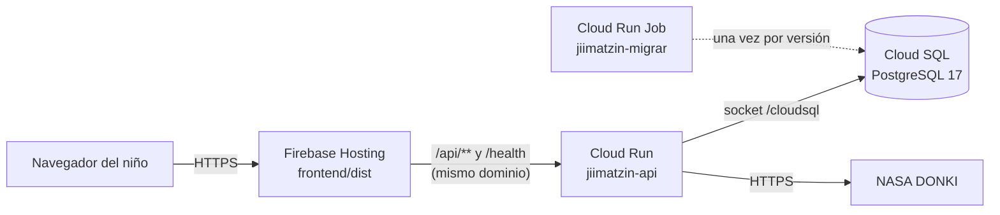

# Despliegue en Google Cloud

Cómo se subieron el juego y la API a Google Cloud. **Ya está desplegado**: <https://project-dd0f486a-7a8b-44de-86e.web.app> (`/health` y `/health/listo` responden `ok`). Los pasos quedan como guía para repetirlo o actualizarlo y los corre quien tenga la
cuenta del equipo (con facturación activa). Ningún secreto va al repositorio ni a un chat.



- **Juego:** archivos estáticos en Firebase Hosting (parte de Google Cloud). Redirige `/api/**` y `/health` a Cloud Run,
  así el juego y la API están en el mismo dominio: no hace falta CORS ni cambiar `API_BASE`.
- **API:** el `Dockerfile` de la raíz, en Cloud Run (escala a cero cuando nadie juega).
- **Base de datos:** Cloud SQL para PostgreSQL 17, conectada por su socket (`host=/cloudsql/...`), que Google ya cifra.
  Por eso aquí `DATABASE_SSL=disable` está permitido en producción (`env.js`).
- **Migraciones:** la misma imagen, como Cloud Run Job.
- **Secreto:** la `DATABASE_URL` vive en Secret Manager.

Los comandos usan la región `us-central1`; cambiarla en todos si se elige otra. `<PROYECTO>` es el id del proyecto.

## 1. Una vez: herramientas y servicios

```bash
gcloud auth login
gcloud config set project <PROYECTO>
gcloud services enable run.googleapis.com sqladmin.googleapis.com artifactregistry.googleapis.com cloudbuild.googleapis.com secretmanager.googleapis.com
npm install -g firebase-tools && firebase login
```

## 2. Base de datos

```bash
gcloud sql instances create jiimatzin-db --database-version=POSTGRES_17 --region=us-central1 --edition=ENTERPRISE --tier=db-f1-micro --storage-size=10
gcloud sql databases create jiimatzin --instance=jiimatzin-db
gcloud sql users create jiimatzin_app --instance=jiimatzin-db --password="<CLAVE_LARGA_AL_AZAR>"
```

## 3. Secreto con la URL de la BD

```bash
printf 'postgresql://jiimatzin_app:<CLAVE>@/jiimatzin?host=/cloudsql/<PROYECTO>:us-central1:jiimatzin-db' | gcloud secrets create jiimatzin-database-url --data-file=-
# la cuenta de servicio de Cloud Run debe poder leer el secreto y conectarse a Cloud SQL
gcloud projects add-iam-policy-binding <PROYECTO> --member="serviceAccount:<NUMERO_PROYECTO>-compute@developer.gserviceaccount.com" --role=roles/secretmanager.secretAccessor
gcloud projects add-iam-policy-binding <PROYECTO> --member="serviceAccount:<NUMERO_PROYECTO>-compute@developer.gserviceaccount.com" --role=roles/cloudsql.client
```

## 4. Imagen de la API

```bash
gcloud artifacts repositories create jiimatzin --repository-format=docker --location=us-central1
gcloud builds submit --tag us-central1-docker.pkg.dev/<PROYECTO>/jiimatzin/api
```

## 5. Migraciones

```bash
gcloud run jobs create jiimatzin-migrar --image=us-central1-docker.pkg.dev/<PROYECTO>/jiimatzin/api --region=us-central1 \
  --set-cloudsql-instances=<PROYECTO>:us-central1:jiimatzin-db --set-secrets=DATABASE_URL=jiimatzin-database-url:latest \
  --command=node --args=node_modules/node-pg-migrate/bin/node-pg-migrate.js,-m,migrations,up
gcloud run jobs execute jiimatzin-migrar --region=us-central1 --wait
```

Volver a ejecutar el job en cada versión que traiga migraciones nuevas.

## 6. API en Cloud Run

```bash
gcloud run deploy jiimatzin-api --image=us-central1-docker.pkg.dev/<PROYECTO>/jiimatzin/api --region=us-central1 \
  --allow-unauthenticated --add-cloudsql-instances=<PROYECTO>:us-central1:jiimatzin-db \
  --set-secrets=DATABASE_URL=jiimatzin-database-url:latest \
  --set-env-vars=NODE_ENV=production,DATABASE_SSL=disable,TRUST_PROXY=1,RATE_LIMIT_MAX=600,CORS_ORIGINS=https://<PROYECTO>.web.app \
  --min-instances=0 --max-instances=3
```

- `RATE_LIMIT_MAX=600`: en una escuela todos los niños salen a internet con la misma IP; con 120 por minuto, una clase
  entera podría recibir 429 al empezar a la vez.
- `TRUST_PROXY`: comprobar en los registros de Cloud Run que los límites se cuentan por niño y no por el CDN; si todas
  las peticiones parecen venir de la misma IP, probar con `2`.

## 7. Juego en Firebase Hosting

```bash
firebase use --add <PROYECTO>
pnpm --filter @jiimatzin/frontend construir     # arma frontend/dist (index.html, src/ y public/)
firebase deploy --only hosting
```

`firebase.json` (raíz) ya tiene las redirecciones a `jiimatzin-api`. El plan gratuito de Firebase transfiere 360 MB al
día y la primera partida baja unos 15 a 20 MB: para una clase conviene el plan de pago por uso (Blaze), que es barato.

## 8. Comprobar

Sitio desplegado: <https://project-dd0f486a-7a8b-44de-86e.web.app>. Con este sitio el juego y la API comparten dominio.

1. `https://<PROYECTO>.web.app/health` → `{"estado":"ok"}` y `/health/listo` → `{"estado":"ok","bd":"ok"}`.
2. Jugar un sol completo y dormir en el Refugio: la partida se guarda al terminar el sol.
3. Ver que llegó (solo el equipo, desde su computadora con el [Cloud SQL Auth Proxy](https://cloud.google.com/sql/docs/postgres/sql-proxy)):
   `pnpm --filter @jiimatzin/backend partidas -- resumen` con `DATABASE_URL` apuntando al proxy.

## Los datos de los jugadores

| Qué | Cómo |
| --- | --- |
| Qué se guarda | Por partida: personaje, dificultad, idioma, soles, resultado, medalla y puntaje, el dominio de cada tema y cada prueba de aprendizaje (tema, tipo, acierto, sol). Tabla `aprendizaje.*` |
| Quién es el jugador | Un código al azar de su navegador (UUID). Sin nombres, correos, IP ni ubicación; la API rechaza cualquier campo de más |
| Para qué | Que el equipo estudie cómo se aprende con el juego y ajuste el modelo (BKT) |
| Quién lo ve | Solo el equipo, con el CLI (`partidas -- exportar`). No hay ruta HTTP para leerlo. Acceso a Cloud SQL por IAM |
| Aviso | En la portada del juego y en el reporte para adultos |
| Borrar | El reporte para adultos muestra el código del dispositivo; con él: `partidas -- borrar --jugador <código>` |
| Conservación | Decidido: 12 meses; se borran las partidas de más de 12 meses (falta programar el borrado periódico) |

Aunque los datos son anónimos, juegan niños de 7 a 12 años: confirmen con el líder local de Space Apps (y con la escuela,
si se juega en clase) que el aviso es suficiente.

## Costos aproximados

Cloud SQL `db-f1-micro` es lo único que cobra siempre (unos pocos dólares al mes más el disco). Cloud Run escala a cero
y Firebase Hosting y Artifact Registry tienen capas gratuitas. Pongan una alerta de presupuesto en la consola.
