# Flujos del sistema (diagramas)

Diagramas Mermaid del comportamiento actual del backend y de las partes del juego que se conectan con él
(partidas anónimas, IA guía, ciclo del sol y despliegue), listos para el entregable. Cada uno
tiene su fuente independiente en [diagramas/](diagramas/) (`flujo-NN-*.mmd`) y se ve con la
vista previa de Markdown de VS Code. Reflejan el código en `backend/src/`, `frontend/src/` y las
migraciones; si cambia un flujo, se actualiza el diagrama junto con el código. Versión en inglés:
[en/14-system-flows.md](en/14-system-flows.md).

| N.º | Diagrama | Qué responde |
| --- | --- | --- |
| 1 | [Panorama](#1-panorama-del-sistema) | Qué piezas hay y cómo se conectan |
| 2 | [Ciclo de vida del contenido](#2-ciclo-de-vida-del-contenido-de-punta-a-punta) | Del paquete de datos a lo que ve el juego |
| 3 | [Importación científica](#3-importación-del-paquete-científico) | Cómo se carga el paquete sin corromper datos |
| 4 | [Publicación científica](#4-estados-de-la-publicación-científica) | Cuándo un paquete puede publicarse |
| 5 | [Importación del juego](#5-importación-de-los-catálogos-del-juego) | Cómo se cargan personajes, minijuegos, cartas… |
| 6 | [Estados del escenario](#6-estados-de-un-escenario) | Borrador, publicado y retirado |
| 7 | [Petición HTTP](#7-recorrido-de-una-petición-http) | Capas, validación y errores de la API |
| 8 | [Consulta de escenario](#8-consulta-de-un-escenario) | Qué ocurre en `GET /scenarios/{id}` |
| 9 | [Ficha científica](#9-cuándo-se-sirve-una-ficha) | Condiciones para devolver o negar una ficha |
| 10 | [DONKI en vivo](#10-fulguraciones-donki-en-vivo) | Caché, petición única y copia obsoleta |
| 11 | [Carga en el frontend](#11-carga-del-escenario-en-el-frontend) | API primero, respaldo estático después |
| 12 | [Arranque y cierre](#12-arranque-y-cierre-del-servidor) | Validación de entorno y cierre ordenado |
| 13 | [Guardado de una partida](#13-guardado-de-una-partida-anónima) | Cola local, validación estricta y escritura atómica |
| 14 | [Ciclo de un sol](#14-ciclo-de-un-sol-en-el-juego) | Mañana, día, emergencia y noche en el juego |
| 15 | [IA guía](#15-la-ia-guía-mide-y-adapta-la-ayuda) | Del acierto del niño a la ayuda que recibe |
| 16 | [Despliegue](#16-despliegue) | Dónde vive cada pieza en producción |

## 1. Panorama del sistema

El contenido entra solo por comandos administrativos (nunca por HTTP). La API es de lectura y tiene **una sola
escritura**: `POST /api/v1/partidas`, que guarda partidas anónimas del juego en el esquema `aprendizaje`; solo el equipo
las lee, con el CLI `partidas`. La única consulta a un servicio externo es DONKI, y no se guarda en la base de datos.

<!-- archivo: flujo-01-panorama -->
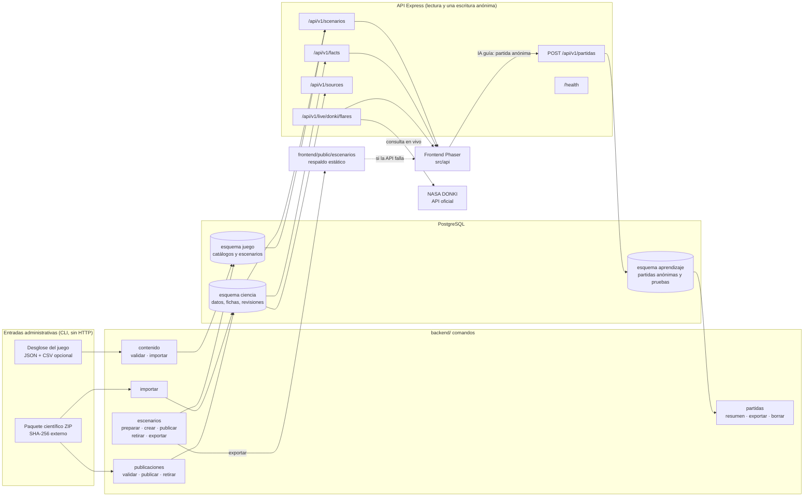

## 2. Ciclo de vida del contenido de punta a punta

Muestra el orden real de los pasos y qué paso exige el siguiente. Un escenario solo llega al juego
cuando la ciencia que referencia está publicada y revisada por una persona.

<!-- archivo: flujo-02-ciclo-contenido -->
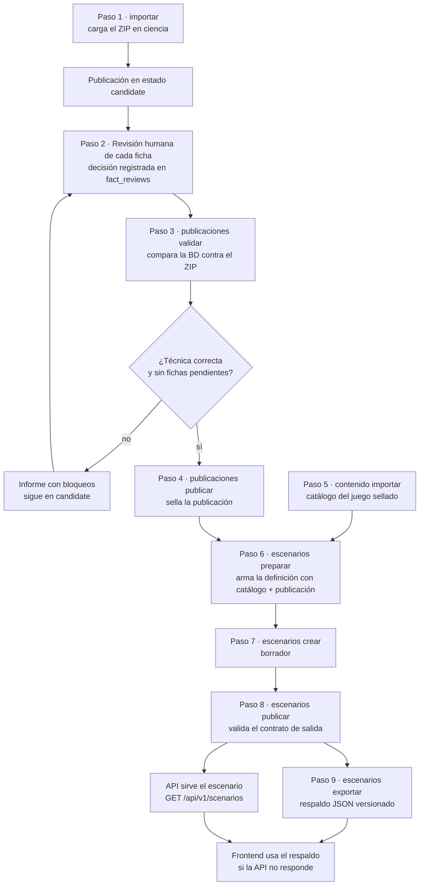

## 3. Importación del paquete científico

`pnpm importar` verifica antes de escribir, carga todo en una transacción y es repetible:
volver a cargar el mismo paquete no duplica ni sobrescribe nada. Un contenido distinto con la
misma identidad aborta la carga.

<!-- archivo: flujo-03-importacion-cientifica -->
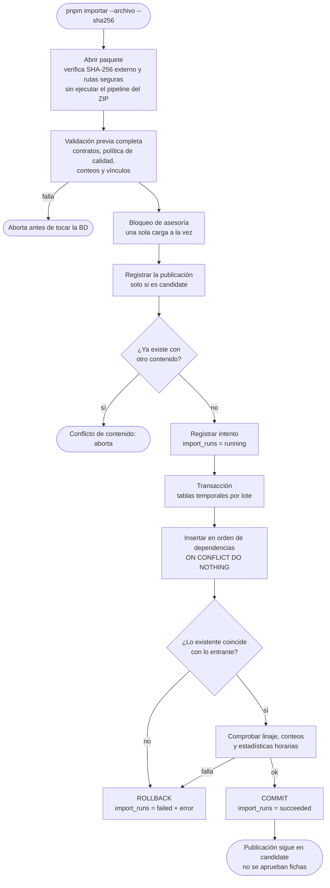

## 4. Estados de la publicación científica

La publicación nace `candidate`. Validar no cambia su estado: solo registra un informe. Publicar
exige validación técnica correcta y que cada ficha usada tenga una última decisión humana de
aprobación.

<!-- archivo: flujo-04-estados-publicacion -->
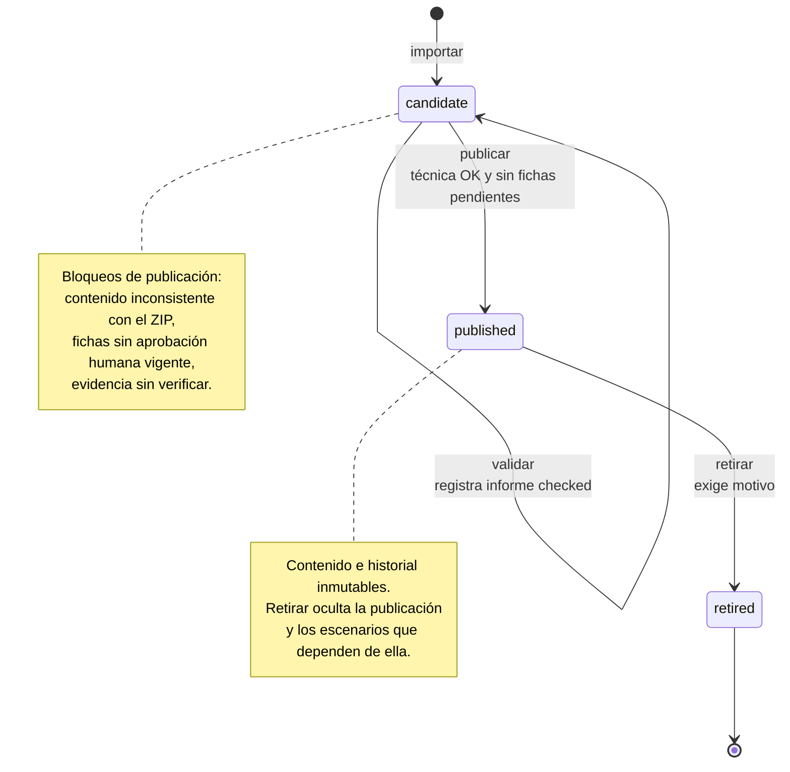

## 5. Importación de los catálogos del juego

El catálogo se identifica por el hash de su contenido ordenado (`cat_<sha256>`). Importar dos veces
el mismo desglose no cambia nada; un cambio genera un catálogo nuevo.

<!-- archivo: flujo-05-importacion-juego -->
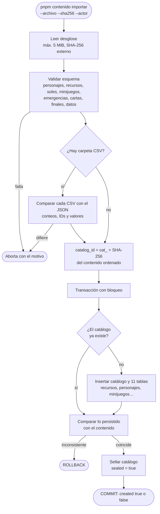

## 6. Estados de un escenario

Un escenario es una versión inmutable que fija la publicación científica, las revisiones de fichas
y las reglas del juego. Cada cambio de estado queda en la bitácora de eventos.

<!-- archivo: flujo-06-estados-escenario -->
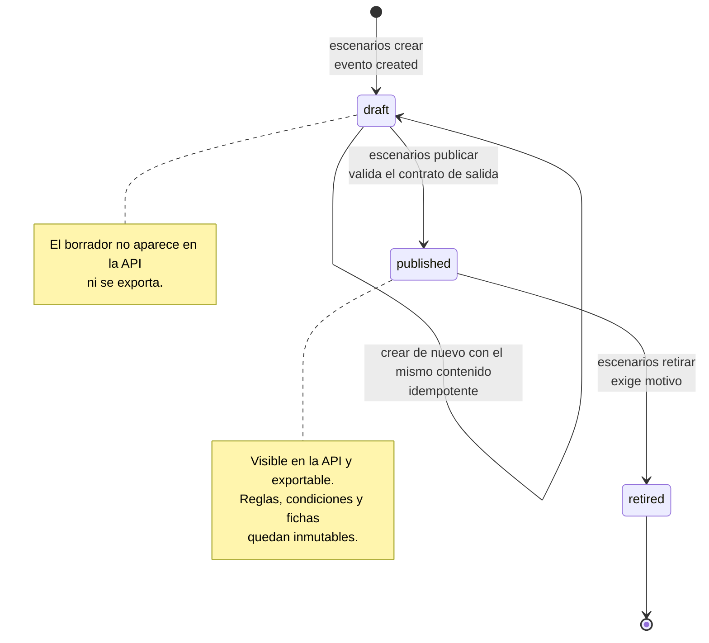

## 7. Recorrido de una petición HTTP

Cada recurso sigue las mismas capas. La validación ocurre en el controlador, el SQL solo en el
repositorio y el formato público solo en la vista. `partidas` es la única ruta `POST`: valida con
un esquema estricto (rechaza campos de más), acepta cuerpos de hasta 64 KB y responde 201, 200 o 409.

<!-- archivo: flujo-07-peticion-http -->
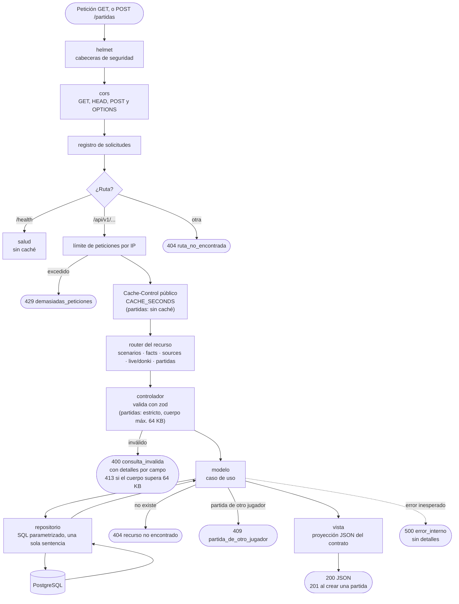

## 8. Consulta de un escenario

Una sola sentencia lee el escenario, sus condiciones, fichas, procedencia y catálogo del juego en
la misma instantánea de PostgreSQL. Sin `version`, devuelve la publicada más reciente.

<!-- archivo: flujo-08-consulta-escenario -->
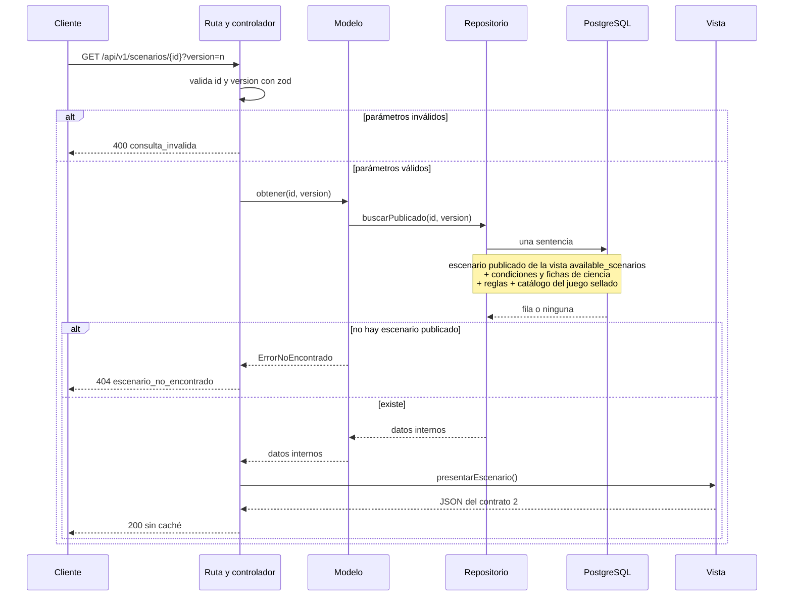

## 9. Cuándo se sirve una ficha

La API nunca toma el estado del paquete como aprobación: manda la última decisión humana. Una
aprobación vieja no se salta un rechazo o una revisión pendiente posterior.

<!-- archivo: flujo-09-ficha-aprobada -->
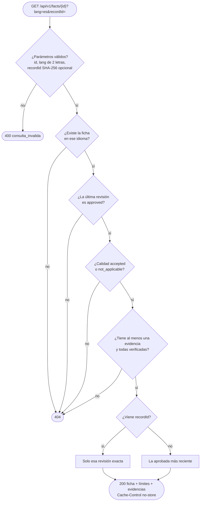

## 10. Fulguraciones DONKI en vivo

DONKI es casi en tiempo real. El servidor cachea por ventana de fechas, hace una sola petición a
NASA por ventana aunque lleguen varias a la vez y, si NASA falla, sirve la última copia buena
(hasta 1 hora) marcada como obsoleta.

<!-- archivo: flujo-10-donki-en-vivo -->
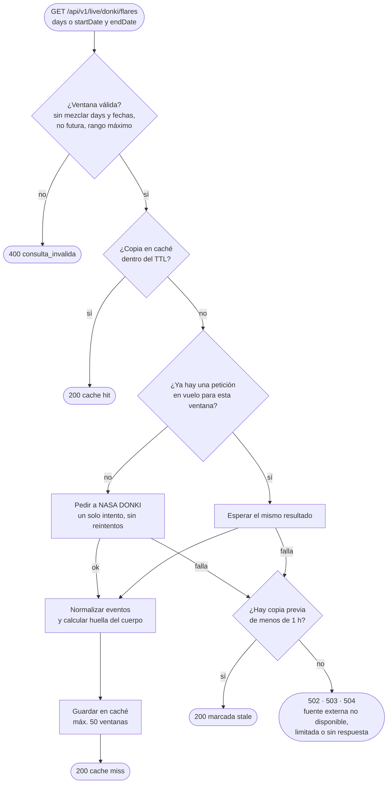

## 11. Carga del escenario en el frontend

La API manda. El respaldo estático solo se usa ante una caída (red, tiempo agotado, respuesta no
válida, error 5xx o límite 429). Un 400 o 404 explícito de la API no se sustituye, para no servir
contenido retirado.

<!-- archivo: flujo-11-carga-frontend -->
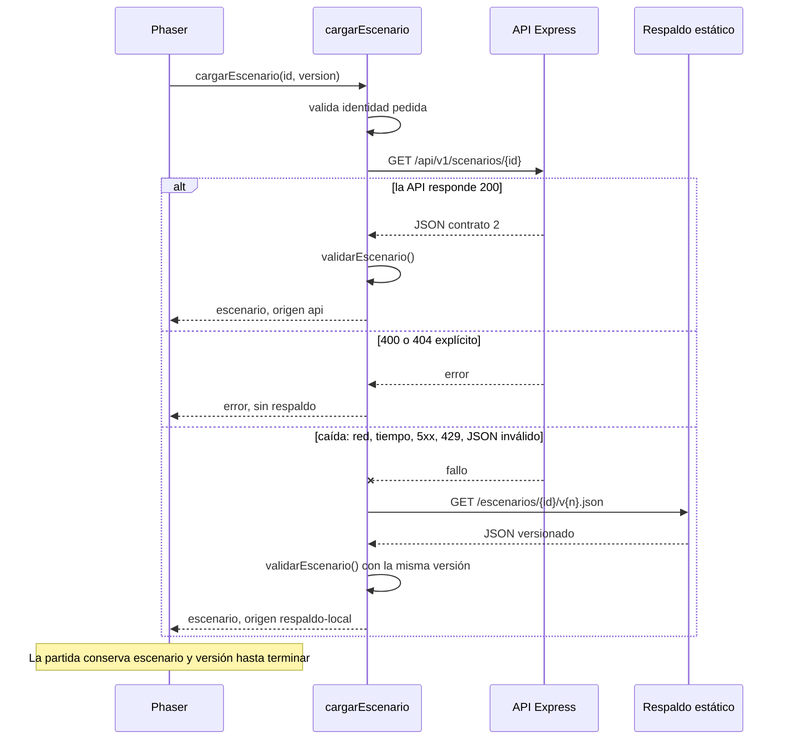

## 12. Arranque y cierre del servidor

En producción la API no arranca con configuración insegura. El proceso se cierra de forma
ordenada y, ante un estado desconocido, se registra y sale para que el hosting lo reinicie.

<!-- archivo: flujo-12-arranque-cierre -->
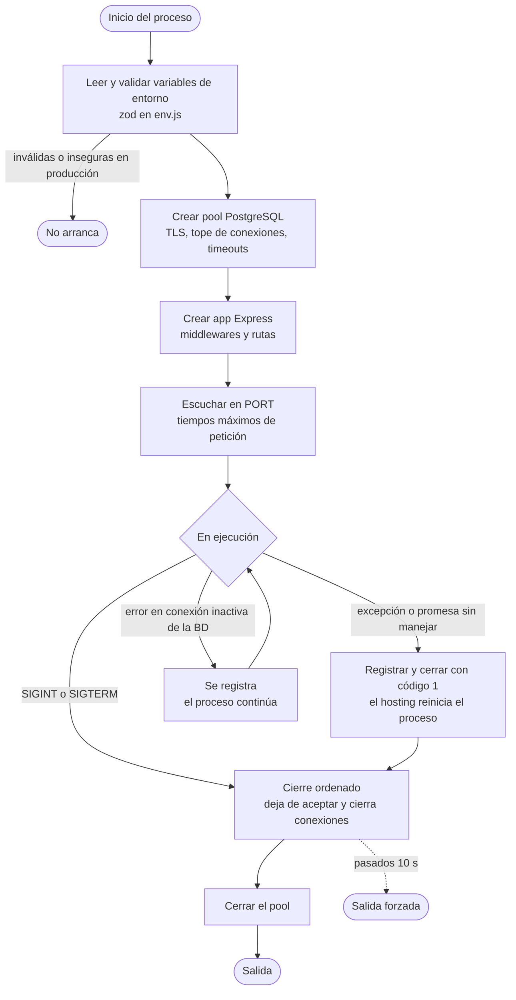

## 13. Guardado de una partida anónima

La IA guía deja la partida en una cola local y la manda al terminar cada sol y la misión. El
servidor valida con un esquema estricto y escribe en una sola sentencia atómica; reenviar la
misma partida la actualiza y nunca la duplica. Si la partida pertenece a otro jugador, no se toca.

<!-- archivo: flujo-13-guardar-partida -->
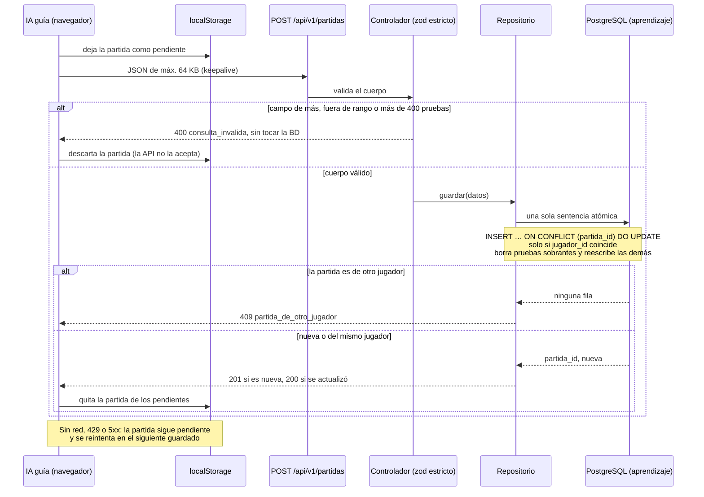

## 14. Ciclo de un sol en el juego

Cada sol recorre mañana, día, emergencia y noche. La IA dicta la hora que ven el mapa y la interfaz;
el estado de las reglas (`GameState.fase`) y el reloj anunciado son distintos. Una partida termina
al completar el sol 10 o cuando un recurso (energía, oxígeno o blindaje) llega a cero.

<!-- archivo: flujo-14-ciclo-sol -->
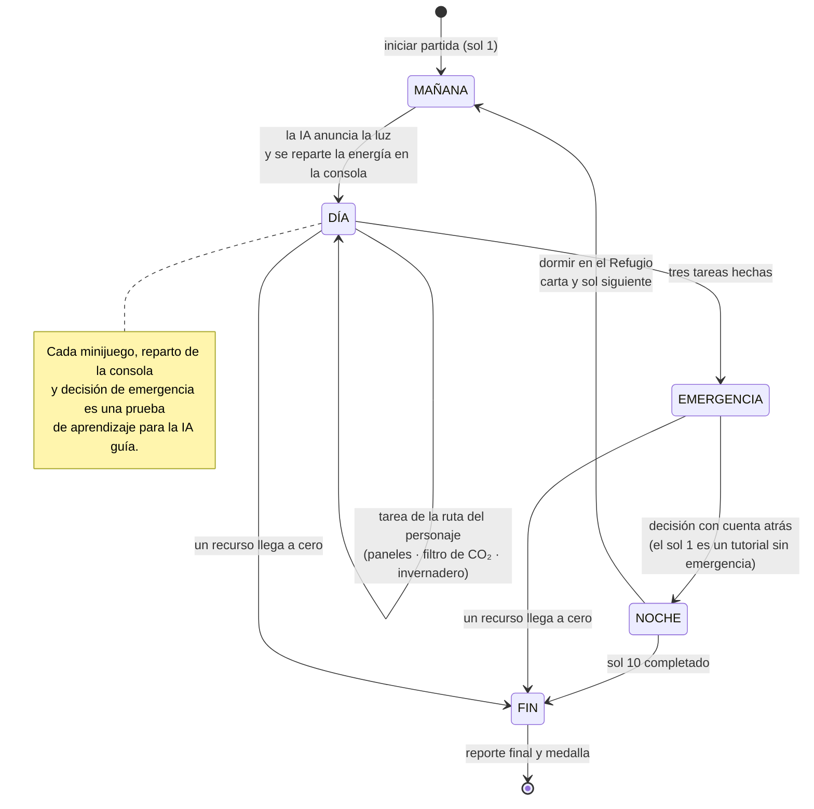

## 15. La IA guía mide y adapta la ayuda

Todo el machine learning del juego corre en el navegador. Cada prueba actualiza el dominio del tema
con Bayesian Knowledge Tracing; la política pedagógica elige el tipo de ayuda y, si hay varias
posibles, un bandido con muestreo de Thompson aprende cuál le funciona a ese niño. Solo el resumen
anónimo viaja a la API.

<!-- archivo: flujo-15-ia-guia -->
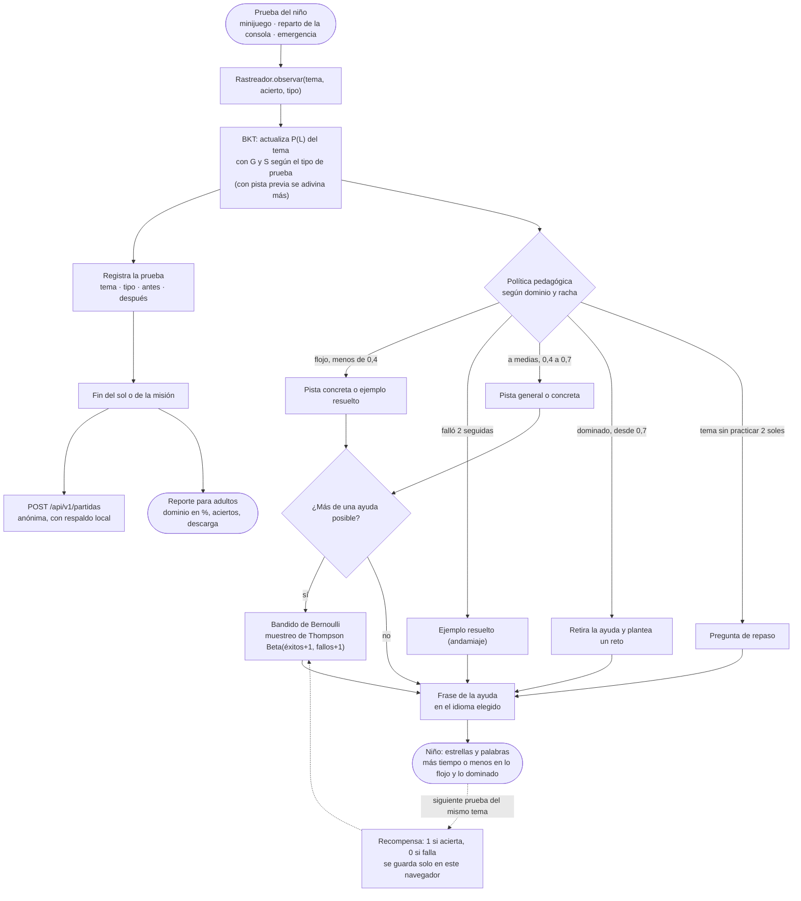

## 16. Despliegue

El juego es estático y puede publicarse en GitHub Pages (automático con cada push a `main`) o en Firebase
Hosting; con Firebase, `/api/**` y `/health` pasan por el mismo dominio a Cloud Run y no hace falta CORS.
La API y las migraciones salen de la misma imagen. Pasos en [07-google-cloud.md](07-google-cloud.md). Ambos sitios
ya están publicados: Google Cloud (<https://project-dd0f486a-7a8b-44de-86e.web.app>, con API y base de datos) y GitHub Pages (<https://as9689138.github.io/juniorAstronautMissionTrainer_JIIMATZIN/>, solo el juego estático).

<!-- archivo: flujo-16-despliegue -->
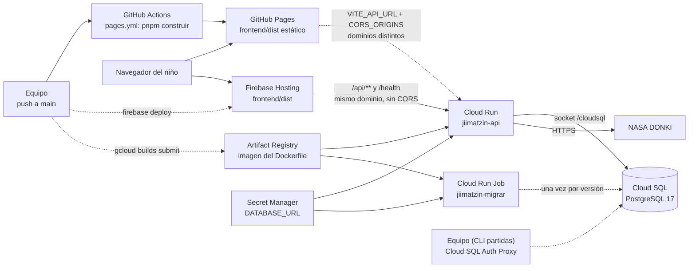

