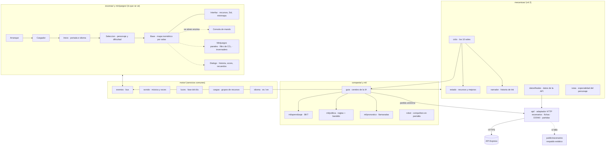

# Arquitectura del frontend

El juego es una aplicación web en **Phaser 4** con JavaScript de módulos ES, sin empaquetador ni dependencias que instalar
(Phaser e `inkjs` viajan en `frontend/public/lib/`). Se comunica con el backend solo por HTTP y nunca toca PostgreSQL.
La guía de uso, los controles y el arte están en [frontend/README.md](../frontend/README.md); aquí se explica cómo
está construido.

## Capas

- **Bus de eventos** (`motor/eventos.js`): las partes del juego no se llaman entre sí; publican y escuchan eventos
  (`EV.INTERACTUAR`, `EV.HORA`, `EV.ESTADO_CAMBIO`…). Las pantallas que se abren encima del mapa (consola, minijuegos,
  diálogo) se registran después en `main.js` para dibujarse por encima. Acuerdos detallados en
  [frontend/docs/acuerdos.md](../frontend/docs/acuerdos.md).
- **Estado único** (`mecanicas/estado.js`): `GameState` guarda sol, fase, personaje, dificultad, recursos
  (energía, oxígeno, blindaje) y mejoras; cada cambio se publica por el bus y la interfaz y el mapa lo leen del registro.
- **La IA dicta la hora:** la luz del mapa y la ficha del Sol cambian solo cuando la IA anuncia la fase en un diálogo;
  `GameState.fase` es la fase de las reglas y `GameState.reloj` la anunciada.

## Un sol de juego

El detalle de fases y transiciones está en el [diagrama 14](14-flujos-backend.md#14-ciclo-de-un-sol-en-el-juego).

| Fase | Qué ocurre |
| --- | --- |
| Mañana | La IA anuncia el amanecer y el jugador reparte la energía en la consola de mando (6 núcleos disponibles frente a 9 necesarios) |
| Día | Tres tareas, en el orden de la ruta del personaje: limpiar paneles, filtro de CO₂ e invernadero |
| Emergencia | La de cada sol (`emergencia_calor`, `fuga`, `co2`, `radiacion`, `polvo`, `impacto`, `comunicacion`, `solar`); el sol 1 es un tutorial sin emergencia y el 10 sortea una |
| Noche | La IA dicta el consumo; el jugador duerme en el Refugio, lee una carta y pasa al sol siguiente |
| Fin | Éxito tras el sol 10, o derrota si energía, oxígeno o blindaje llegan a cero; reporte final con medalla |

## Carga de datos y respaldo

`mecanicas/datosReales.js` pide la misión `base-marte-uno` al adaptador de `src/api`; el juego nunca llama a `fetch`
directamente. El flujo de caída (API → respaldo estático → contenido propio) está en el
[diagrama 11](14-flujos-backend.md#11-carga-del-escenario-en-el-frontend). Además consulta las llamaradas de los últimos
7 días (`/live/donki/flares`) para la antena de Comunicaciones; ese dato nunca dispara reglas del juego.

## Carga de recursos por grupos

`motor/cargas.js` reparte los archivos en grupos para que el menú pese 4,6 MB (72 archivos) en lugar de 16,3 MB
(175 archivos). La tabla de grupos y cuándo se liberan está en el [README del frontend](../frontend/README.md#carga-y-memoria).

## Idiomas

Español e inglés se eligen en la portada. Todo texto de Phaser pasa por el diccionario `src/textos/en.js` al dibujarse
(`motor/idioma.js`); la historia en inglés vive en `src/textos/historia_en.js`. Hay voces grabadas en español y, en inglés,
habla la voz del navegador.

## La IA guía

Es la única parte con machine learning y funciona sin servidor: BKT para estimar el dominio de cada tema, una
política pedagógica con un bandido de Thompson para elegir la ayuda y una regresión logística para el pronóstico de
llamaradas. Ver [16-aprendizaje-partidas.md](16-aprendizaje-partidas.md) y el
[diagrama 15](14-flujos-backend.md#15-la-ia-guía-mide-y-adapta-la-ayuda).

## Despliegue

Se publica como archivos estáticos (`pnpm --filter @jiimatzin/frontend construir` → `frontend/dist`): en GitHub Pages
con el flujo `.github/workflows/pages.yml` (cada push a `main`) o en Firebase Hosting. Ver el
[diagrama 16](14-flujos-backend.md#16-despliegue) y [07-google-cloud.md](07-google-cloud.md).
