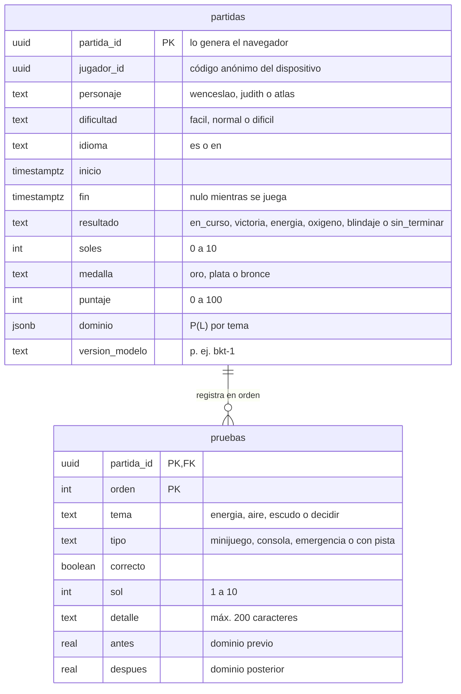

# Aprendizaje y partidas anónimas

La IA guía del juego mide cuánto domina el niño cuatro temas y adapta la ayuda. Para estudiar cómo se aprende con el
juego y ajustar el modelo, guarda de forma **anónima** cada partida en el esquema `aprendizaje` de PostgreSQL. Es la única
escritura de la API (`POST /api/v1/partidas`). Contrato y respuestas: [04-api.md](04-api.md#partidas-del-juego-única-escritura).

## Cómo mide y adapta

Todo corre en el navegador (`frontend/src/ml/` y `frontend/src/compania/`); el diagrama completo está en el
[diagrama 15](14-flujos-backend.md#15-la-ia-guía-mide-y-adapta-la-ayuda).

| Pieza | Archivo | Qué hace |
| --- | --- | --- |
| Medición | `ml/aprendizaje.js` | Bayesian Knowledge Tracing: probabilidad `P(L)` de dominar cada tema (energía, aire, escudo, decidir con datos), con `L0 = 0,25` y `T = 0,15`. Adivinar (`G`) y resbalar (`S`) dependen del tipo de prueba; con una pista previa se adivina más |
| Política | `ml/politica.js` | Reglas de enseñanza según el dominio y la racha de errores: pista, ejemplo resuelto, reto sin ayuda, elogio de la estrategia, pregunta del porqué, corrección o repaso |
| Aprendizaje por refuerzo | `ml/politica.js` | Si las reglas dejan más de una ayuda, un bandido de Bernoulli con muestreo de Thompson (`Beta(éxitos+1, fallos+1)`) elige; la recompensa es acertar la siguiente prueba del tema. Se guarda solo en el navegador |
| Pronóstico solar | `ml/pronostico.js` | Regresión logística entrenada con datos reales de NOAA |
| Orquestación | `compania/guia.js` | Une las piezas, calcula la calificación (70 % aprendizaje y 30 % soles resistidos; oro desde 80, plata desde 60) y manda la partida |

Cada prueba (minijuego, reparto de la consola o decisión de emergencia) guarda tema, tipo, acierto, sol, dominio antes y
después. Los parámetros iniciales son los típicos de la literatura; cuando haya partidas se pueden ajustar con datos.

## Modelo de datos `aprendizaje`

Migración: [20261119000000_partidas-aprendizaje.sql](../backend/migrations/20261119000000_partidas-aprendizaje.sql).
Fuente del diagrama: [diagramas/aprendizaje-er.mmd](diagramas/aprendizaje-er.mmd).



| Tabla | Clave | Restricciones destacadas |
| --- | --- | --- |
| `aprendizaje.partidas` | `partida_id` | Listas cerradas de personaje, dificultad, idioma y resultado; `soles` 0–10; `puntaje` 0–100; `dominio` debe ser un objeto JSON; `version_modelo` con patrón `^[a-z0-9._-]{1,40}$`. Índices por `jugador_id` y `recibida_en` |
| `aprendizaje.pruebas` | `(partida_id, orden)` | Borrado en cascada con la partida; `tema` y `tipo` de listas cerradas; `antes` y `despues` entre 0 y 1; `detalle` de 200 caracteres como máximo |

## Guardado

El juego deja la partida en una cola de `localStorage` y la manda al terminar cada sol y la misión; sin red, con 429 o
con 5xx, se reintenta en el siguiente guardado. El servidor valida con un esquema estricto (cualquier campo de más, como un
nombre, se rechaza) y escribe en **una sola sentencia atómica**: crea la partida o la actualiza si ya existe y es del mismo
jugador, y reescribe sus pruebas. Reenviar no duplica. Una partida de otro jugador devuelve 409 y no se modifica.
Secuencia en el [diagrama 13](14-flujos-backend.md#13-guardado-de-una-partida-anónima).

## Privacidad

| Qué | Cómo |
| --- | --- |
| Identidad | Un UUID al azar que genera el navegador. Sin nombres, correos, IP ni ubicación |
| Lectura | No hay ruta HTTP; solo el equipo, con el CLI |
| Aviso | En la portada del juego y en el reporte para adultos |
| Borrado | El reporte para adultos muestra el código del dispositivo; con él se ejecuta `partidas -- borrar --jugador <código>` |
| Conservación | Decidido: 12 meses; se borran las partidas de más de 12 meses (falta programar el borrado periódico) |

Juegan niños de 7 a 12 años: aunque los datos son anónimos, conviene confirmar con el líder local de Space Apps (y con la
escuela, si se juega en clase) que el aviso es suficiente.

## CLI para el equipo

```bash
pnpm --filter @jiimatzin/backend partidas -- resumen
pnpm --filter @jiimatzin/backend partidas -- exportar --salida partidas.csv --desde 2026-11-01
pnpm --filter @jiimatzin/backend partidas -- borrar --jugador <uuid>
```

`resumen` cuenta partidas, jugadores, pruebas, victorias y puntaje medio; `exportar` escribe una fila por prueba (no
sobrescribe un archivo existente); `borrar` elimina todo lo de un jugador. Requiere `DATABASE_URL`.
