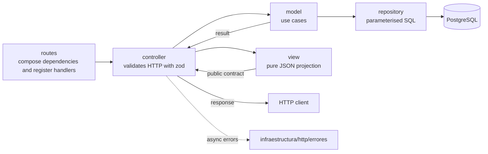
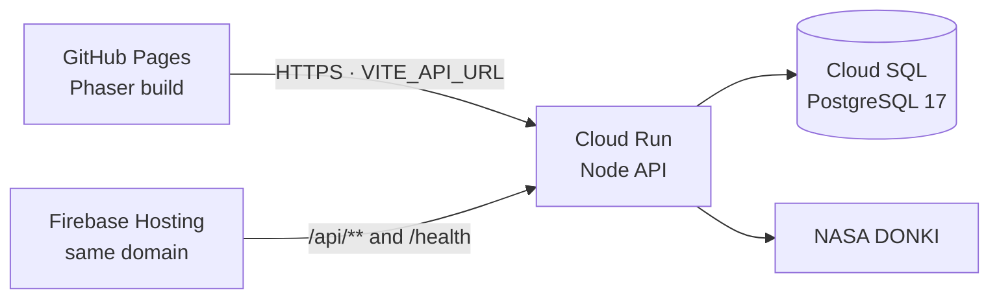

# Architecture

> English version of [../02-arquitectura.md](../02-arquitectura.md).

## Components and responsibilities

The whole picture (administrative inputs, commands, schemas, API and front end) is in [diagram 1](14-system-flows.md#1-system-overview).

| Component | Proposed owner (doc 04) |
| --- | --- |
| Import, database, content endpoints | Role 3 |
| HTTP adapter and loading in Phaser | Role 1 |
| Rules, effects and balance | Role 2 |
| Story text and labels | Role 5, with scientific review by role 3 |

Principles: the front end **never** connects to the database; the back end does **not** query NASA per player (DONKI is cached per date window); the game's resource logic stays in the mechanics module, not in the API; the only write of the API is the game's anonymous sessions. The game's architecture is in [15-frontend.md](15-frontend.md) and the guide AI's in [16-learning-and-sessions.md](16-learning-and-sessions.md).

## Loading a scenario

The scenario query in the API and its loading in the front end, with static fallback, are in diagrams [8](14-system-flows.md#8-querying-a-scenario) and [11](14-system-flows.md#11-loading-the-scenario-in-the-front-end).

## Back-end internal structure

The back end follows **screaming architecture with MVC per feature**. Opening `backend/src/` shows `escenarios/`, `fichas/`, `fuentes/`, `donki/`, `partidas/`, `salud/`, `importador/`, `contenido/` and `publicaciones/`. The folders say what the API does; every HTTP resource holds its model, view, controller, routes and repository.

### MVC in this API

- **Model:** coordinates queries and resolves use cases. The selection of published scenarios and approved fact cards stays in the SQL of their repositories. The model receives the repository by injection and knows nothing about Express, HTTP status codes or environment variables.
- **View:** turns internal data into the contract JSON (public names, versions, conditions, fact cards and evidence). It receives no `req`/`res` and never queries PostgreSQL.
- **Controller:** validates parameters and queries, calls the model and sends the view's result with the right HTTP status. Express 5 propagates async errors to the common middleware.
- **Routes:** compose the local dependencies and map URL → controller; they hold no SQL, validation or response building.

`app.js` wires configuration, middleware and routers; `rutas.js` groups `/api/v1`. `infraestructura/` holds configuration, the pool and HTTP middleware. `compartido/errores.js` defines application errors with no transport dependencies; the middleware turns a missing resource into 404 and hides unexpected errors behind a 500.

The scientific importers (`src/importador/`) and the game-breakdown importer (`src/contenido/`) are implemented administrative commands. They validate inputs, load inside transactions and keep content-based identities. They expose no content-write routes. The exception is `partidas/`, which follows the same pattern (without a view, because it answers with a minimal acknowledgement) and exposes `POST /api/v1/partidas`; its CLI summarises, exports and deletes what has been stored. Scenarios pin the revisions of both parts and their view builds the public response; see [catalogues](12-game-content.md).

### Rules for extending

1. Create a folder named after the feature and keep its `*.model.js`, `*.view.js`, `*.controller.js`, `*.repository.js` and `*.routes.js` files together.
2. Keep SQL in repositories and the public format in views. Pass dependencies through the existing factories.
3. Mount content routes in `backend/src/rutas.js` and add HTTP tests with representative responses and errors.
4. Update the documentation; if the public contract changes, agree it with roles 1 and 2 and update the schema and adapter.

## Front ↔ back connection

| Environment | How they connect |
| --- | --- |
| Development | Vite (5173) with an `/api` proxy → `localhost:3000`; no CORS |
| Production, same domain | Reverse proxy: `/api` goes to the API |
| Production, different domains | `VITE_API_URL` points to the API and `CORS_ORIGINS` includes the front end's origin |

## Deployment

The game is published on **GitHub Pages** with `.github/workflows/pages.yml` on every push to `main`. The intended destination for the API is Google Cloud (Firebase Hosting, Cloud Run and Cloud SQL); the steps are in [07-google-cloud.md](07-google-cloud.md) and have not been run yet. See [diagram 16](14-system-flows.md#16-deployment).

GitHub Pages only serves static files: dynamic endpoints need a host that runs a server and can reach PostgreSQL. Requirements: `DATABASE_URL` only on the server, a list of CORS origins and backups.
