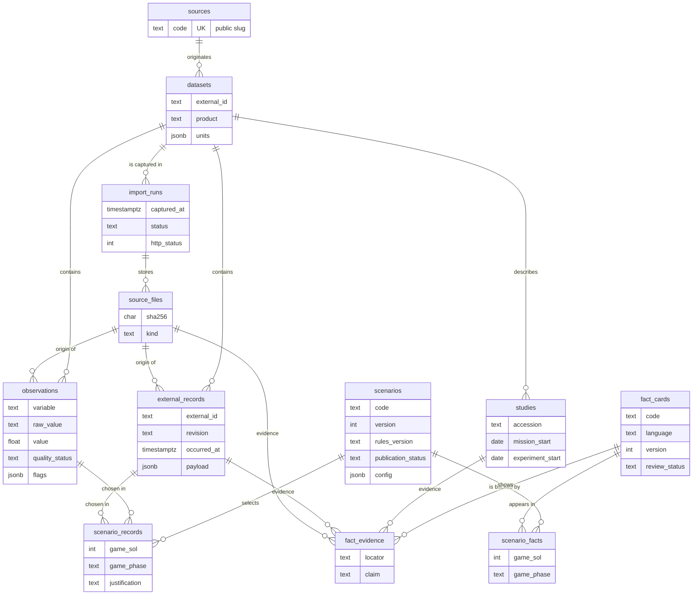

# Data model

> English version of [../03-modelo-datos.md](../03-modelo-datos.md).

The model described here is the initial `public` schema. The adjusted standardised package is modelled in the `ciencia` schema, with 28 tables (26 scientific and 2 for publication): see the [dictionary](../10-diccionario-bd.md) and the [ER diagram](../11-diagrama-er.md) (Spanish, generated). The source and fact-card endpoints already query `ciencia`; scenarios use `juego` and the scientific memberships. The importer and the scenario–publication link are implemented; the `juego` schema has 19 tables: five for scenarios and fourteen for catalogues and links. The game breakdown is loaded by version, separately from science; see [content](12-game-content.md) and the [game model](../13-modelo-juego.md).

A fourth schema, `aprendizaje` (2 tables), stores the game's anonymous sessions and their learning probes; see [16-learning-and-sessions.md](16-learning-and-sessions.md). See also the [API](04-api.md) and [import](05-import.md).

| Schema | Tables | Written by | Document |
| --- | --- | --- | --- |
| `public` | initial schema (no longer served) | initial migration | this document |
| `ciencia` | 28 (26 scientific and 2 for publication) | importer and publications (CLI) | [10](../10-diccionario-bd.md), [11](../11-diagrama-er.md) |
| `juego` | 19 (5 for scenarios and 14 for catalogues) | content and scenarios (CLI) | [12](12-game-content.md), [13](../13-modelo-juego.md) |
| `aprendizaje` | 2 (`partidas`, `pruebas`) | `POST /api/v1/partidas` | [16](16-learning-and-sessions.md) |

Implemented in [backend/migrations/20261114000000_esquema-inicial.sql](../../backend/migrations/20261114000000_esquema-inicial.sql). It is the schema proposed in doc 04, **still subject to approval**.

## Rules built into the schema

| Rule (origin) | How it is enforced |
| --- | --- |
| Each piece of evidence points to **one** valid reference (doc 04 §5) | `CHECK num_nonnulls(study_id, external_record_id, source_file_id) = 1` |
| A scenario record is an observation **or** an external record | `CHECK num_nonnulls(observation_id, external_record_id) = 1` |
| −999 is not a temperature (doc 04 §6) | `raw_value` keeps the original; `value` is `NULL` and `quality_status = 'missing'` |
| Transport ≠ experiment in OSDR (doc 03 §5) | `mission_start/end` separate from `experiment_start/end` (null if not established) |
| Phenomenon date ≠ capture ≠ game sol (doc 04 §7) | `occurred_at`/`observed_at`, `import_runs.captured_at` and `game_sol` are separate columns |
| Re-importing does not duplicate (doc 04 §6) | `UNIQUE (uri, sha256)`, `(dataset_id, external_id, revision)`, `(source_file_id, record_index, variable)` |
| A revision in use is never deleted (doc 04 §5) | FKs are `RESTRICT` by default; only children of the scenario/card itself cascade |
| 404/500 errors are not data (doc 04 §6) | `import_runs.status = 'failed'` + `http_status`; no rows in `observations` |
| Interpretation ≠ measurement (doc 03 §5) | Editorial text only in `fact_cards` with `review_status`; the API publishes only `approved` |
| A published scenario pins versions | `scenario_facts` points to a concrete `fact_cards` row (code + version) |

## Design notes

- `public.fact_cards.code` identifies the cards of the initial scenario. The new `GET /facts/{id}` looks up `ciencia.fact_cards.fact_key`; the two catalogues need an explicit editorial mapping.
- `mission_sol` is Curiosity's sol; `game_sol` is the day of the fictional mission (1 to 10). Do not confuse them.
- JSONB keeps the payload but does not replace the original file: the hash lives in `source_files`.
- Still to decide: an editorial table for OSDR `uso_candidato`/`limite` (doc 03 §8) and a REMS quality policy.
