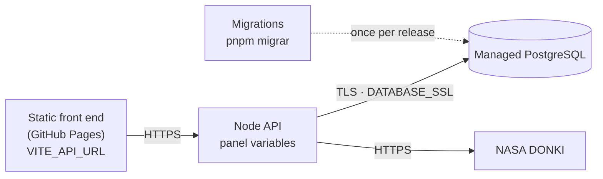

# Production

> English version of [../06-produccion.md](../06-produccion.md).

The back end is deployed configured **only by environment variables**, defined in the hosting panel. In production no `.env` file is used or uploaded. If a critical variable is missing or insecure, the API **does not start** (validation in [backend/src/infraestructura/config/env.js](../../backend/src/infraestructura/config/env.js)).

## Variables

| Variable | Production | Notes |
| --- | --- | --- |
| `NODE_ENV` | `production` | Enables the strict validations |
| `PORT` | whatever the host assigns | Almost all hosts inject it; default 3000 |
| `DATABASE_URL` | URL of the managed database | Mandatory; server only. Rejected if it points to `localhost` or uses the development password |
| `DATABASE_SSL` | `require` (or `no-verify`) | `disable` is rejected in production, except with Cloud SQL through its socket (`host=/cloudsql/...`), which is already encrypted. Use `no-verify` only if the provider uses its own certificate |
| `CORS_ORIGINS` | `https://<front-end-origin>` | Mandatory; exact `https` origins only, no wildcard or path. Several separated by commas |
| `TRUST_PROXY` | `1` behind a load balancer | For real IP and protocol |
| `DB_POOL_MAX` | 10 by default | Adjust to the database plan's connection limit |
| `RATE_LIMIT_MAX` / `RATE_LIMIT_WINDOW_S` | 120 requests per 60 s per IP | `0` is rejected in production. Needs a correct `TRUST_PROXY` behind a load balancer |
| `CACHE_SECONDS` | 60 | Public `Cache-Control` of the content; `/health` and errors are always `no-store` |
| `DONKI_BASE_URL` | `https://ccmc.gsfc.nasa.gov/DONKI-API` | Optional; live endpoint, no key. The server needs internet access |
| `DONKI_CACHE_SECONDS` / `DONKI_TIMEOUT_MS` / `DONKI_MAX_DAYS` | 300 / 10000 / 30 | Optional; cache, timeout and maximum query range |

`DATA_DIR` is used only by the importer and is not needed to serve the API.

## Hardening included

| Measure | Where |
| --- | --- |
| The API does not start with insecure configuration in production | `infraestructura/config/env.js` |
| Security headers (`helmet`), no `X-Powered-By` | `app.js` |
| Closed CORS: GET/HEAD/POST and only listed origins | `app.js` |
| Per-IP rate limit (429 with its own format) | `infraestructura/http/limites.js` |
| Maximum request and header times | `index.js` |
| Orderly shutdown and forced exit after 10 s | `index.js` |
| An error on an idle database connection does not bring the process down | `index.js` |
| Unhandled exceptions/promises: log and exit so the host restarts | `index.js` |
| A single write: `POST /api/v1/partidas` (anonymous game sessions), validated with strict Zod, body of 64 KB at most and no route to read it back; parameterised SQL; database limits (`statement_timeout` 5 s) | `partidas/`, per-feature repositories, `infraestructura/db/pool.js` |
| 500 errors reveal no details | `infraestructura/http/errores.js` |

## Deployment

The complete diagram with Google Cloud is [diagram 16](14-system-flows.md#16-deployment).

## Checklist

1. Create the managed database and copy its URL to `DATABASE_URL` in the panel (never in the repository or a chat).
2. Apply the migrations against that database: `pnpm migrar` with `DATABASE_URL` pointing to it.
3. Define `NODE_ENV`, `DATABASE_SSL`, `CORS_ORIGINS` and `TRUST_PROXY` in the panel.
4. Start with `pnpm --filter @jiimatzin/backend start`.
5. Check `GET /health` and `GET /health/listo`.
6. In the front end, build with `VITE_API_URL` pointing to the API's public URL.
7. Rotate any credential that has passed through a chat or a file.

## Pending

- Hosting: Google Cloud (Firebase Hosting + Cloud Run + Cloud SQL). Steps in [07-google-cloud.md](07-google-cloud.md); they still need to be run with the team's account.
- Decide who runs the migrations on each deployment (manual or a pipeline step).
- Structured logging, if traffic justifies it (per-IP rate limiting already exists).
- Retention policy for the anonymous sessions (proposal: 12 months); see [16-learning-and-sessions.md](16-learning-and-sessions.md).
- When real data is imported: a database backup strategy.
