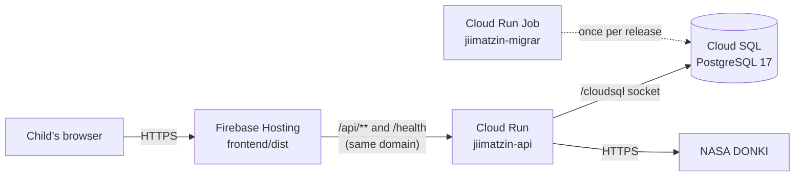

# Deploying to Google Cloud

> English version of [../07-google-cloud.md](../07-google-cloud.md).

How the game and the API were put on Google Cloud. **It is already deployed**: <https://project-dd0f486a-7a8b-44de-86e.web.app> (`/health` and `/health/listo` answer `ok`). The steps remain as a guide to repeat or update it and are to be run by whoever holds the team's account (with billing enabled). No secret goes into the repository or a chat.



- **Game:** static files on Firebase Hosting (part of Google Cloud). It redirects `/api/**` and `/health` to Cloud Run, so the game and the API share a domain: no CORS and no change to `API_BASE` are needed.
- **API:** the root `Dockerfile`, on Cloud Run (scales to zero when nobody plays).
- **Database:** Cloud SQL for PostgreSQL 17, connected through its socket (`host=/cloudsql/...`), which Google already encrypts. That is why `DATABASE_SSL=disable` is allowed in production here (`env.js`).
- **Migrations:** the same image, as a Cloud Run Job.
- **Secret:** `DATABASE_URL` lives in Secret Manager.

The commands use region `us-central1`; change it everywhere if you choose another. `<PROJECT>` is the project id.

## 1. Once: tools and services

```bash
gcloud auth login
gcloud config set project <PROJECT>
gcloud services enable run.googleapis.com sqladmin.googleapis.com artifactregistry.googleapis.com cloudbuild.googleapis.com secretmanager.googleapis.com
npm install -g firebase-tools && firebase login
```

## 2. Database

```bash
gcloud sql instances create jiimatzin-db --database-version=POSTGRES_17 --region=us-central1 --edition=ENTERPRISE --tier=db-f1-micro --storage-size=10
gcloud sql databases create jiimatzin --instance=jiimatzin-db
gcloud sql users create jiimatzin_app --instance=jiimatzin-db --password="<LONG_RANDOM_PASSWORD>"
```

## 3. Secret with the database URL

```bash
printf 'postgresql://jiimatzin_app:<PASSWORD>@/jiimatzin?host=/cloudsql/<PROJECT>:us-central1:jiimatzin-db' | gcloud secrets create jiimatzin-database-url --data-file=-
# Cloud Run's service account must be able to read the secret and connect to Cloud SQL
gcloud projects add-iam-policy-binding <PROJECT> --member="serviceAccount:<PROJECT_NUMBER>-compute@developer.gserviceaccount.com" --role=roles/secretmanager.secretAccessor
gcloud projects add-iam-policy-binding <PROJECT> --member="serviceAccount:<PROJECT_NUMBER>-compute@developer.gserviceaccount.com" --role=roles/cloudsql.client
```

## 4. API image

```bash
gcloud artifacts repositories create jiimatzin --repository-format=docker --location=us-central1
gcloud builds submit --tag us-central1-docker.pkg.dev/<PROJECT>/jiimatzin/api
```

## 5. Migrations

```bash
gcloud run jobs create jiimatzin-migrar --image=us-central1-docker.pkg.dev/<PROJECT>/jiimatzin/api --region=us-central1 \
  --set-cloudsql-instances=<PROJECT>:us-central1:jiimatzin-db --set-secrets=DATABASE_URL=jiimatzin-database-url:latest \
  --command=node --args=node_modules/node-pg-migrate/bin/node-pg-migrate.js,-m,migrations,up
gcloud run jobs execute jiimatzin-migrar --region=us-central1 --wait
```

Run the job again on every release that brings new migrations.

## 6. API on Cloud Run

```bash
gcloud run deploy jiimatzin-api --image=us-central1-docker.pkg.dev/<PROJECT>/jiimatzin/api --region=us-central1 \
  --allow-unauthenticated --add-cloudsql-instances=<PROJECT>:us-central1:jiimatzin-db \
  --set-secrets=DATABASE_URL=jiimatzin-database-url:latest \
  --set-env-vars=NODE_ENV=production,DATABASE_SSL=disable,TRUST_PROXY=1,RATE_LIMIT_MAX=600,CORS_ORIGINS=https://<PROJECT>.web.app \
  --min-instances=0 --max-instances=3
```

- `RATE_LIMIT_MAX=600`: in a school every child reaches the internet through the same IP; with 120 per minute a whole class could get 429 when starting at once.
- `TRUST_PROXY`: check in the Cloud Run logs that limits are counted per child and not per CDN; if every request seems to come from the same IP, try `2`.

## 7. Game on Firebase Hosting

```bash
firebase use --add <PROJECT>
pnpm --filter @jiimatzin/frontend construir     # builds frontend/dist (index.html, src/ and public/)
firebase deploy --only hosting
```

`firebase.json` (root) already has the redirects to `jiimatzin-api`. Firebase's free plan transfers 360 MB per day and the first game downloads about 15 to 20 MB: for a class the pay-as-you-go plan (Blaze) is advisable, and it is cheap.

## 8. Check

Deployed site: <https://project-dd0f486a-7a8b-44de-86e.web.app>. On this site the game and the API share a domain.

1. `https://<PROJECT>.web.app/health` → `{"estado":"ok"}` and `/health/listo` → `{"estado":"ok","bd":"ok"}`.
2. Play a full sol and sleep in the Refuge: the session is saved when the sol ends.
3. Check it arrived (team only, from their computer with the [Cloud SQL Auth Proxy](https://cloud.google.com/sql/docs/postgres/sql-proxy)): `pnpm --filter @jiimatzin/backend partidas -- resumen` with `DATABASE_URL` pointing to the proxy.

## Players' data

| What | How |
| --- | --- |
| What is stored | Per session: character, difficulty, language, sols, result, medal and score, the mastery of each topic and every learning probe (topic, type, correct, sol). Table `aprendizaje.*` |
| Who the player is | A random code from their browser (UUID). No names, e-mails, IP or location; the API rejects any extra field |
| What for | So the team can study how children learn with the game and adjust the model (BKT) |
| Who sees it | Only the team, with the CLI (`partidas -- exportar`). There is no HTTP route to read it. Access to Cloud SQL through IAM |
| Notice | On the game's title screen and in the adults' report |
| Deleting | The adults' report shows the device code; with it: `partidas -- borrar --jugador <code>` |
| Retention | Decided: 12 months; sessions older than 12 months are deleted (the periodic deletion still has to be scheduled) |

Although the data is anonymous, the players are children aged 7 to 12: confirm with the local Space Apps lead (and with the school, if it is played in class) that the notice is enough.

## Approximate costs

Cloud SQL `db-f1-micro` is the only thing that always costs money (a few dollars a month plus disk). Cloud Run scales to zero and Firebase Hosting and Artifact Registry have free tiers. Set a budget alert in the console.
