# System flows (diagrams)

> English version of [../14-flujos-backend.md](../14-flujos-backend.md). The standalone Mermaid sources in [../diagramas/](../diagramas/) have Spanish labels; the diagrams below are the translated copies.

Mermaid diagrams of the current behaviour of the back end and of the parts of the game that connect to it (anonymous sessions, guide AI, sol cycle and deployment), ready for the deliverable. They reflect the code in `backend/src/`, `frontend/src/` and the migrations; if a flow changes, its diagram is updated together with the code.

| No. | Diagram | What it answers |
| --- | --- | --- |
| 1 | [Overview](#1-system-overview) | Which pieces exist and how they connect |
| 2 | [Content life cycle](#2-end-to-end-content-life-cycle) | From the data package to what the game shows |
| 3 | [Scientific import](#3-importing-the-scientific-package) | How the package is loaded without corrupting data |
| 4 | [Scientific publication](#4-states-of-a-scientific-publication) | When a package can be published |
| 5 | [Game import](#5-importing-the-game-catalogues) | How characters, minigames, cards… are loaded |
| 6 | [Scenario states](#6-states-of-a-scenario) | Draft, published and retired |
| 7 | [HTTP request](#7-path-of-an-http-request) | API layers, validation and errors |
| 8 | [Scenario query](#8-querying-a-scenario) | What happens in `GET /scenarios/{id}` |
| 9 | [Fact card](#9-when-a-fact-card-is-served) | Conditions to return or deny a fact card |
| 10 | [Live DONKI](#10-live-donki-solar-flares) | Cache, single request and stale copy |
| 11 | [Front-end loading](#11-loading-the-scenario-in-the-front-end) | API first, static fallback second |
| 12 | [Start and shutdown](#12-server-start-and-shutdown) | Environment validation and orderly shutdown |
| 13 | [Saving a session](#13-saving-an-anonymous-session) | Local queue, strict validation and atomic write |
| 14 | [Sol cycle](#14-the-cycle-of-a-sol-in-the-game) | Morning, day, emergency and night in the game |
| 15 | [Guide AI](#15-the-guide-ai-measures-and-adapts-its-help) | From the child's answer to the help they get |
| 16 | [Deployment](#16-deployment) | Where each piece lives in production |

## 1. System overview

Content enters only through administrative commands (never through HTTP). The API reads and has **a single write**: `POST /api/v1/partidas`, which stores the game's anonymous sessions in the `aprendizaje` schema; only the team reads them, with the `partidas` CLI. The only query to an external service is DONKI, and it is not stored in the database.

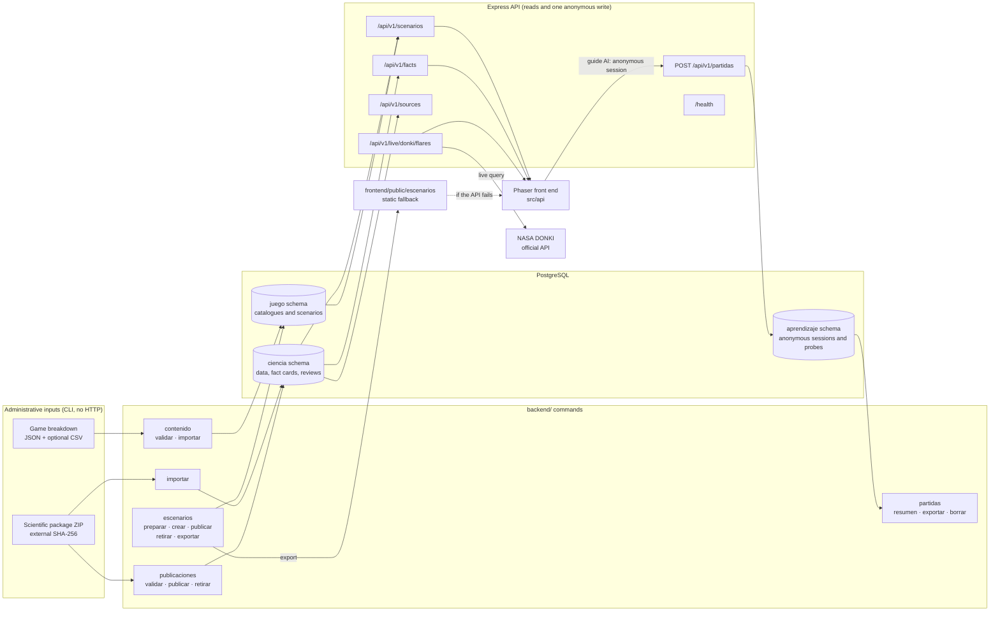

## 2. End-to-end content life cycle

Shows the real order of the steps and which step requires the next. A scenario only reaches the game when the science it references is published and reviewed by a person.

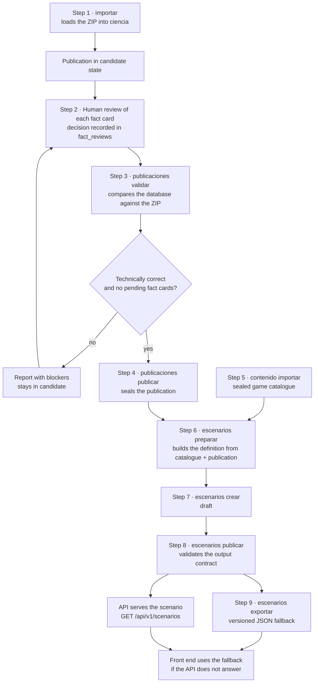

## 3. Importing the scientific package

`pnpm importar` verifies before writing, loads everything in one transaction and is repeatable: loading the same package again neither duplicates nor overwrites anything. Different content with the same identity aborts the load.

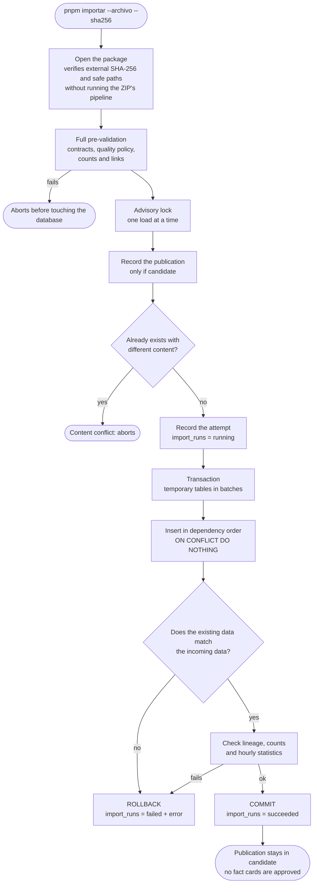

## 4. States of a scientific publication

The publication is born `candidate`. Validating does not change its state: it only records a report. Publishing requires a correct technical validation and that every fact card used has a latest human approval decision.

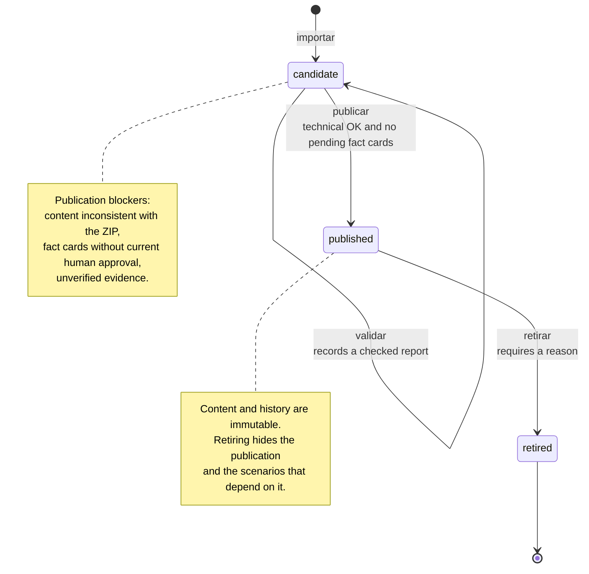

## 5. Importing the game catalogues

The catalogue is identified by the hash of its sorted content (`cat_<sha256>`). Importing the same breakdown twice changes nothing; a change produces a new catalogue.

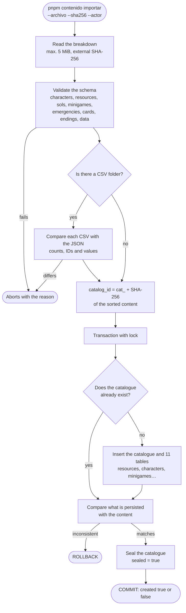

## 6. States of a scenario

A scenario is an immutable version that pins the scientific publication, the fact-card revisions and the game rules. Every state change is recorded in the event log.

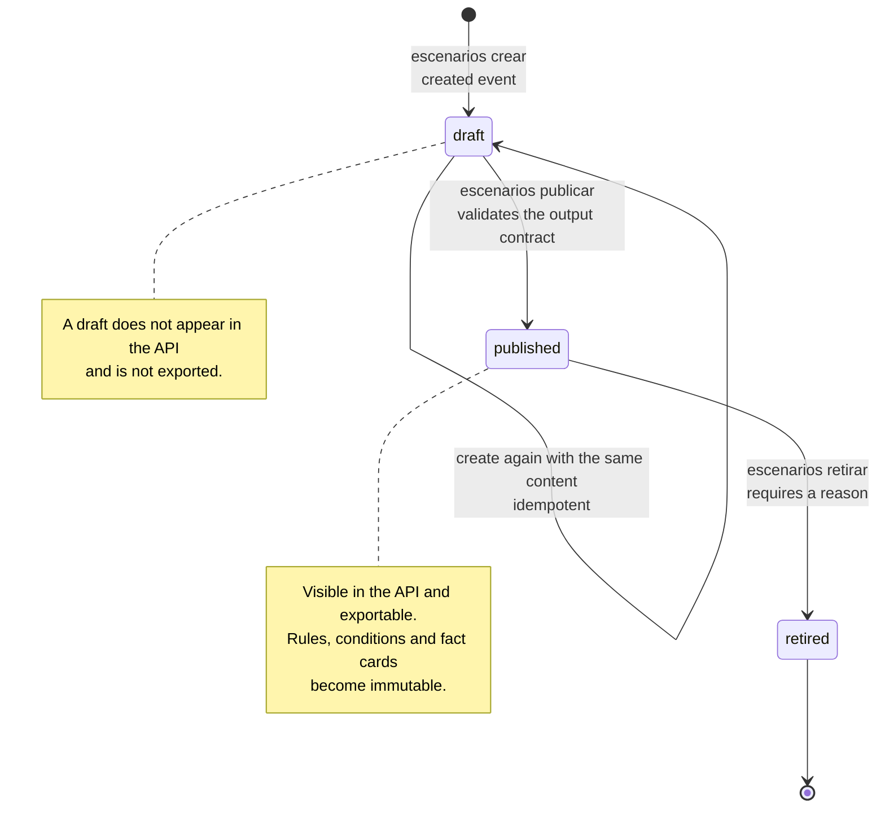

## 7. Path of an HTTP request

Every resource follows the same layers. Validation happens in the controller, SQL only in the repository and the public format only in the view. `partidas` is the only `POST` route: it validates with a strict schema (extra fields are rejected), accepts bodies of up to 64 KB and answers 201, 200 or 409.

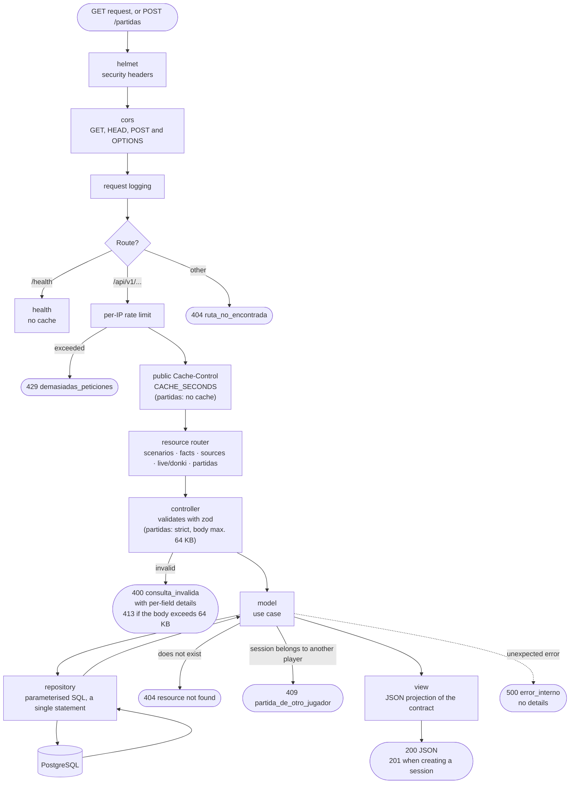

## 8. Querying a scenario

A single statement reads the scenario, its conditions, fact cards, provenance and game catalogue in the same PostgreSQL snapshot. Without `version`, it returns the latest published.

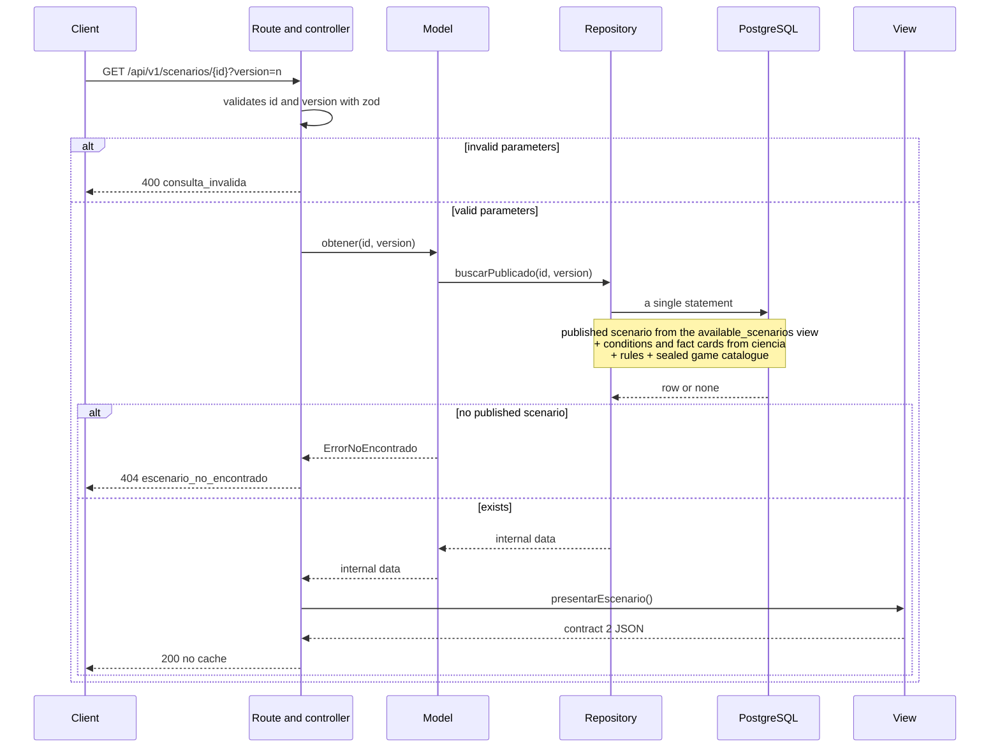

## 9. When a fact card is served

The API never takes the package's status as approval: the latest human decision rules. An old approval does not skip a later rejection or pending review.

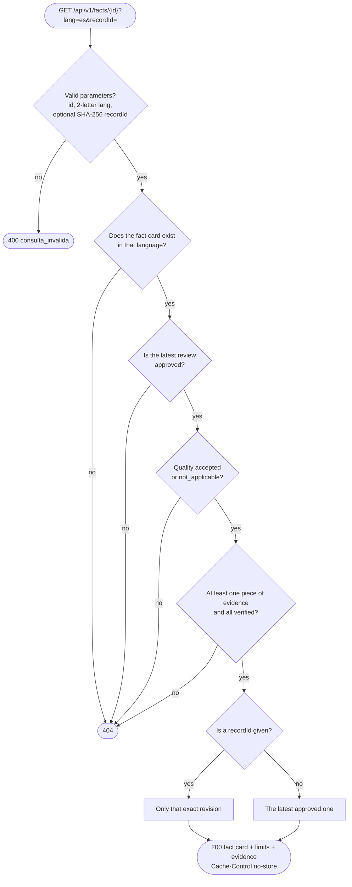

## 10. Live DONKI solar flares

DONKI is near real time. The server caches per date window, makes a single request to NASA per window even if several arrive at once and, if NASA fails, serves the last good copy (up to 1 hour) marked as stale.

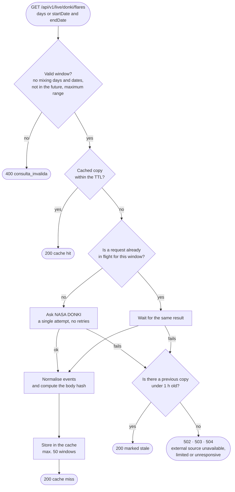

## 11. Loading the scenario in the front end

The API rules. The static fallback is only used on an outage (network, timeout, invalid response, 5xx error or 429 limit). An explicit 400 or 404 from the API is not replaced, so retired content is never served.

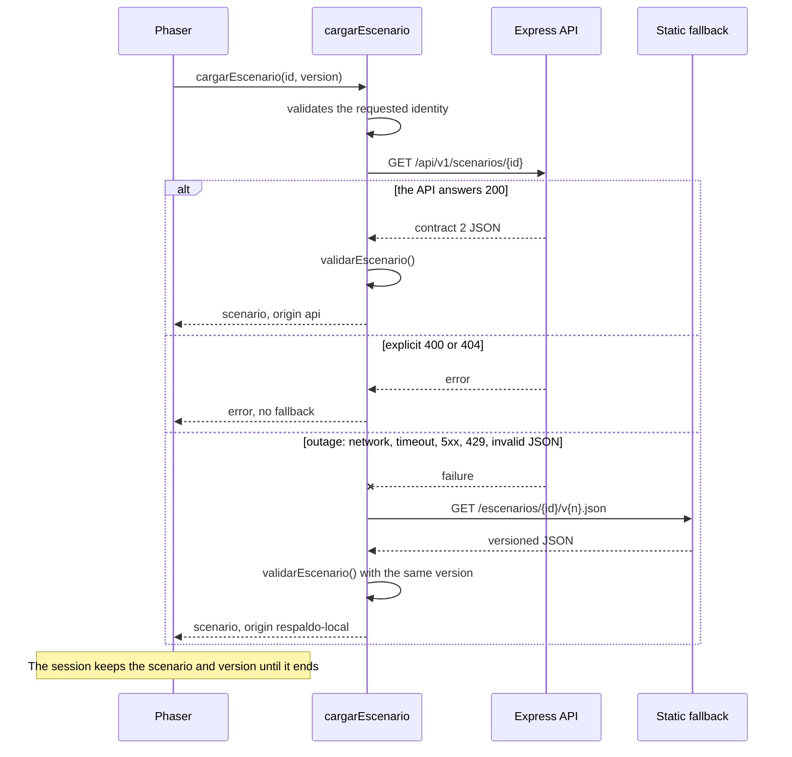

## 12. Server start and shutdown

In production the API does not start with insecure configuration. The process shuts down in an orderly way and, in an unknown state, logs and exits so the host restarts it.

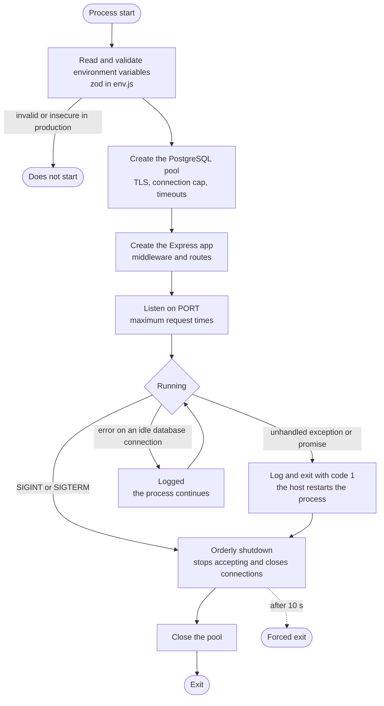

## 13. Saving an anonymous session

The guide AI leaves the session in a local queue and sends it at the end of every sol and of the mission. The server validates with a strict schema and writes in a single atomic statement; re-sending the same session updates it and never duplicates it. If the session belongs to another player, nothing is touched.

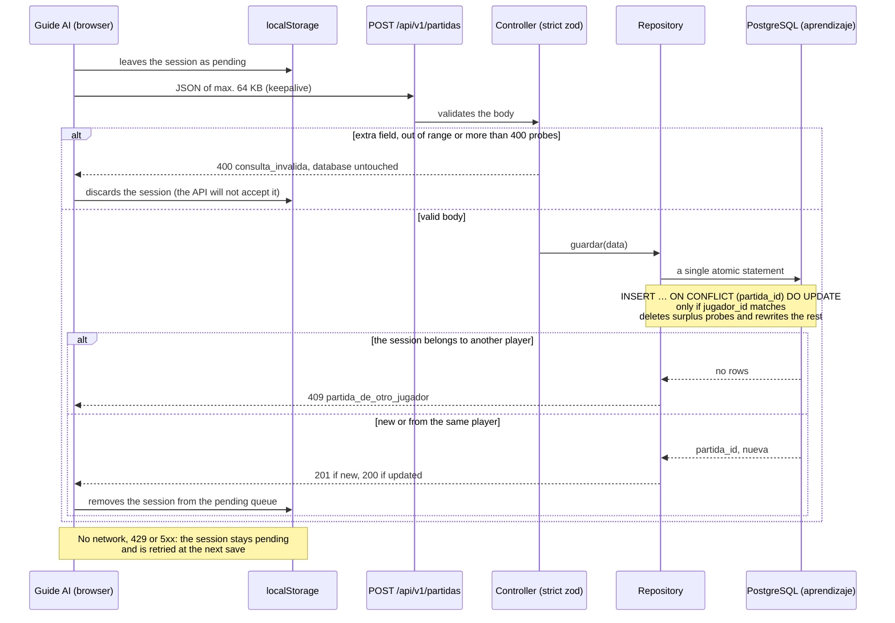

## 14. The cycle of a sol in the game

Every sol goes through morning, day, emergency and night. The AI dictates the time that the map and the interface show; the rules' state (`GameState.fase`) and the announced clock are different things. A game ends on completing sol 10 or when a resource (energy, oxygen or shielding) reaches zero.

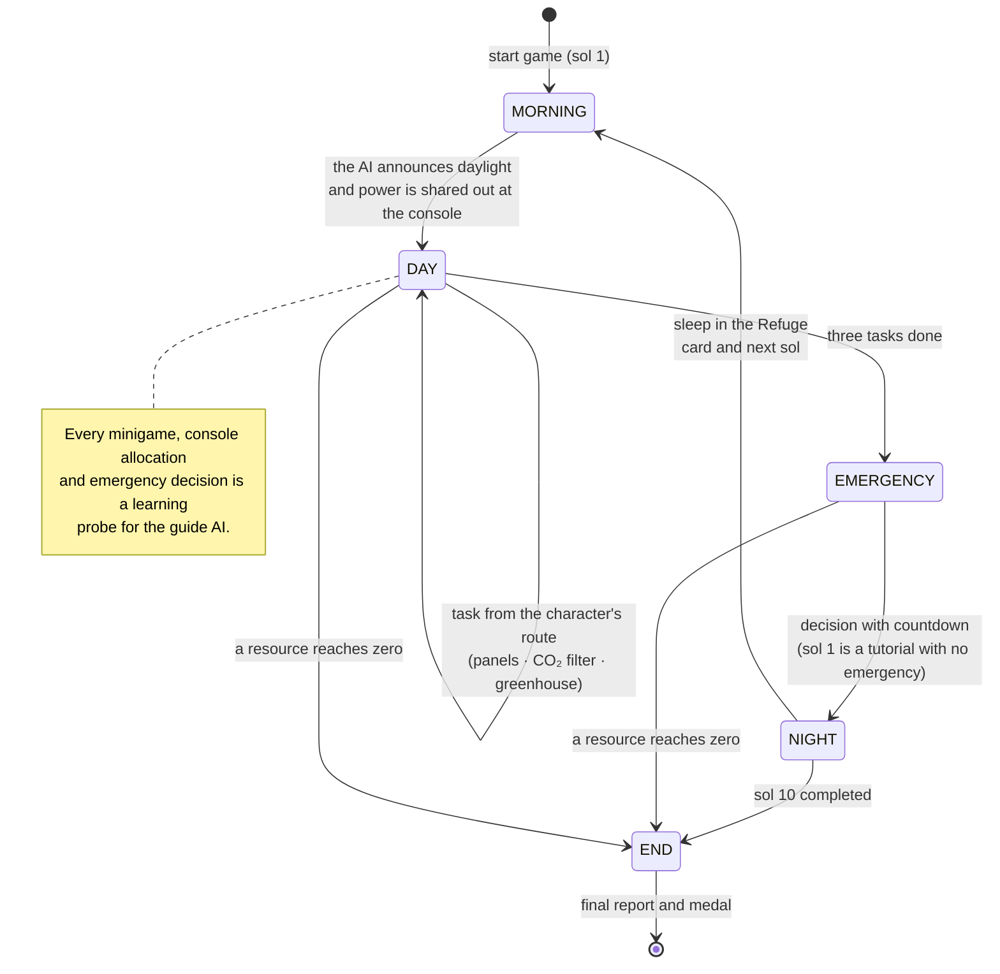

## 15. The guide AI measures and adapts its help

All of the game's machine learning runs in the browser. Every probe updates the topic's mastery with Bayesian Knowledge Tracing; the teaching policy chooses the type of help and, when several are possible, a bandit with Thompson sampling learns which works for that child. Only the anonymous summary travels to the API.

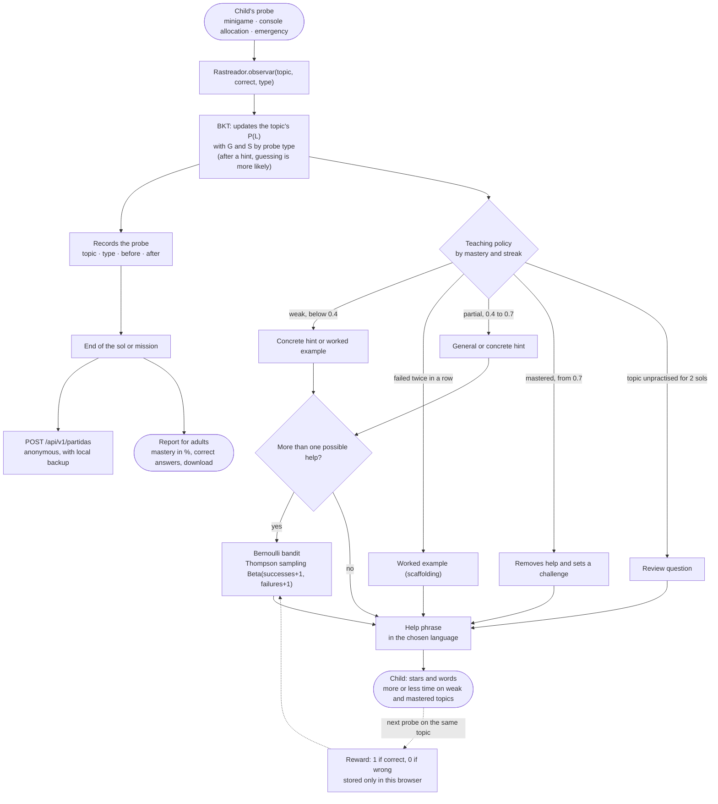

## 16. Deployment

The game is static and can be published on GitHub Pages (automatic on every push to `main`) or on Firebase Hosting; with Firebase, `/api/**` and `/health` go through the same domain to Cloud Run and no CORS is needed. The API and the migrations come from the same image. Steps in [07-google-cloud.md](07-google-cloud.md). Both sites are already published: Google Cloud (<https://project-dd0f486a-7a8b-44de-86e.web.app>, with API and database) and GitHub Pages (<https://as9689138.github.io/juniorAstronautMissionTrainer_JIIMATZIN/>, static game only).

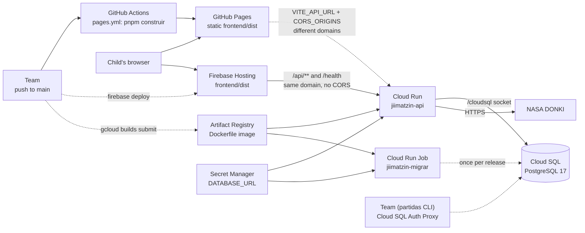
