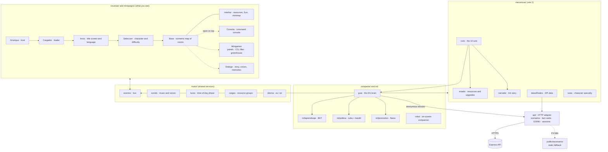

# Front-end architecture

> English version of [../15-frontend.md](../15-frontend.md). File and folder names in the code are in Spanish.

The game is a web application in **Phaser 4** with ES-module JavaScript, with no bundler and nothing to install (Phaser and `inkjs` ship in `frontend/public/lib/`). It talks to the back end only over HTTP and never touches PostgreSQL. The user guide, controls and art pipeline are in [frontend/README.md](../../frontend/README.md) (Spanish); this document explains how it is built.

## Layers

- **Event bus** (`motor/eventos.js`): the parts of the game do not call each other; they publish and listen to events (`EV.INTERACTUAR`, `EV.HORA`, `EV.ESTADO_CAMBIO`…). The screens that open on top of the map (console, minigames, dialogue) are registered later in `main.js` so they draw above it. Detailed agreements in [frontend/docs/acuerdos.md](../../frontend/docs/acuerdos.md) (Spanish).
- **Single state** (`mecanicas/estado.js`): `GameState` holds sol, phase, character, difficulty, resources (energy, oxygen, shielding) and upgrades; every change is published on the bus and the interface and the map read it from the registry.
- **The AI dictates the time:** the map's light and the Sun card change only when the AI announces the phase in a dialogue; `GameState.fase` is the rules' phase and `GameState.reloj` the announced one.

## One game sol

The phases and transitions are detailed in [diagram 14](14-system-flows.md#14-the-cycle-of-a-sol-in-the-game).

| Phase | What happens |
| --- | --- |
| Morning | The AI announces sunrise and the player shares out power at the command console (6 cores available against 9 needed) |
| Day | Three tasks, in the order of the character's route: clean panels, CO₂ filter and greenhouse |
| Emergency | The one of each sol (`emergencia_calor`, `fuga`, `co2`, `radiacion`, `polvo`, `impacto`, `comunicacion`, `solar`); sol 1 is a tutorial with no emergency and sol 10 draws one |
| Night | The AI dictates consumption; the player sleeps in the Refuge, reads a card and moves to the next sol |
| End | Success after sol 10, or defeat if energy, oxygen or shielding reach zero; final report with a medal |

## Data loading and fallback

`mecanicas/datosReales.js` asks the `src/api` adapter for the `base-marte-uno` mission; the game never calls `fetch` directly. The outage flow (API → static fallback → the game's own content) is in [diagram 11](14-system-flows.md#11-loading-the-scenario-in-the-front-end). It also fetches the flares of the last 7 days (`/live/donki/flares`) for the Communications antenna; that datum never triggers game rules.

## Resource loading by groups

`motor/cargas.js` splits files into groups so the menu weighs 4.6 MB (72 files) instead of 16.3 MB (175 files). The table of groups and when they are released is in the [front-end README](../../frontend/README.md#carga-y-memoria).

## Languages

Spanish and English are chosen on the title screen. All Phaser text goes through the dictionary `src/textos/en.js` when drawn (`motor/idioma.js`); the English story lives in `src/textos/historia_en.js`. Recorded voices are in Spanish; in English the browser's voice speaks.

## The guide AI

It is the only part with machine learning and it works without a server: BKT to estimate the mastery of each topic, a teaching policy with a Thompson bandit to choose the help, and a logistic regression for the flare forecast. See [16-learning-and-sessions.md](16-learning-and-sessions.md) and [diagram 15](14-system-flows.md#15-the-guide-ai-measures-and-adapts-its-help).

## Deployment

It is published as static files (`pnpm --filter @jiimatzin/frontend construir` → `frontend/dist`): on GitHub Pages with the `.github/workflows/pages.yml` workflow (every push to `main`, <https://as9689138.github.io/juniorAstronautMissionTrainer_JIIMATZIN/>) and on Firebase Hosting (<https://project-dd0f486a-7a8b-44de-86e.web.app>), which also forwards `/api/**` to the API. See [diagram 16](14-system-flows.md#16-deployment) and [07-google-cloud.md](07-google-cloud.md).
