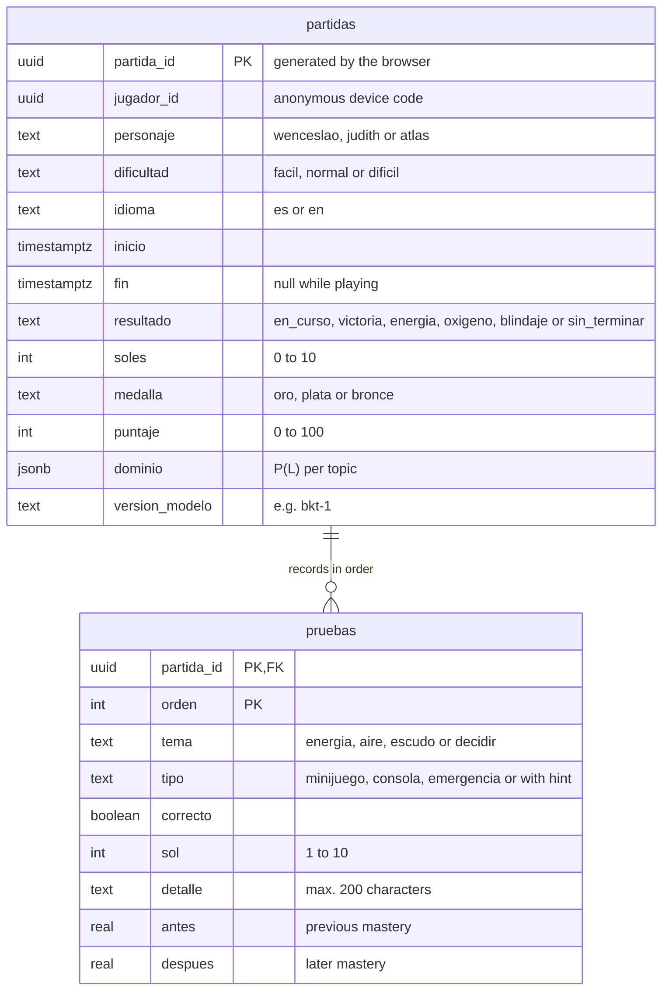

# Learning and anonymous game sessions

> English version of [../16-aprendizaje-partidas.md](../16-aprendizaje-partidas.md). Table and column names are the real identifiers (Spanish).

The game's guide AI measures how well the child has mastered four topics and adapts its help. To study how children learn with the game and tune the model, it stores each game **anonymously** in PostgreSQL's `aprendizaje` schema. It is the API's only write (`POST /api/v1/partidas`). Contract and responses: [04-api.md](04-api.md#game-sessions-the-only-write).

## How it measures and adapts

Everything runs in the browser (`frontend/src/ml/` and `frontend/src/compania/`); the full diagram is [diagram 15](14-system-flows.md#15-the-guide-ai-measures-and-adapts-its-help).

| Piece | File | What it does |
| --- | --- | --- |
| Measurement | `ml/aprendizaje.js` | Bayesian Knowledge Tracing: probability `P(L)` of having mastered each topic (energy, air, shield, deciding with data), with `L0 = 0.25` and `T = 0.15`. Guessing (`G`) and slipping (`S`) depend on the probe type; after a prior hint, guessing is more likely |
| Policy | `ml/politica.js` | Teaching rules by mastery and error streak: hint, worked example, challenge without help, praise of strategy, "why" question, correction or review |
| Reinforcement learning | `ml/politica.js` | When the rules leave more than one possible help, a Bernoulli bandit with Thompson sampling (`Beta(successes+1, failures+1)`) chooses; the reward is answering the topic's next probe correctly. Stored only in the browser |
| Solar forecast | `ml/pronostico.js` | Logistic regression trained on real NOAA data |
| Orchestration | `compania/guia.js` | Joins the pieces, computes the grade (70 % learning and 30 % sols survived; gold from 80, silver from 60) and sends the session |

Every probe (minigame, console allocation or emergency decision) stores topic, type, correctness, sol, and mastery before and after. The initial parameters are the typical ones from the literature; once sessions exist they can be tuned with data.

## The `aprendizaje` data model

Migration: [20261119000000_partidas-aprendizaje.sql](../../backend/migrations/20261119000000_partidas-aprendizaje.sql). Diagram source: [diagramas/aprendizaje-er.mmd](../diagramas/aprendizaje-er.mmd) (Spanish labels).



| Table | Key | Notable constraints |
| --- | --- | --- |
| `aprendizaje.partidas` | `partida_id` | Closed lists for character, difficulty, language and result; `soles` 0–10; `puntaje` 0–100; `dominio` must be a JSON object; `version_modelo` matching `^[a-z0-9._-]{1,40}$`. Indexes on `jugador_id` and `recibida_en` |
| `aprendizaje.pruebas` | `(partida_id, orden)` | Cascade delete with the session; `tema` and `tipo` from closed lists; `antes` and `despues` between 0 and 1; `detalle` at most 200 characters |

## Saving

The game leaves the session in a `localStorage` queue and sends it at the end of every sol and of the mission; with no network, on 429 or on 5xx, it retries at the next save. The server validates with a strict schema (any extra field, such as a name, is rejected) and writes in **a single atomic statement**: it creates the session or updates it if it already exists and belongs to the same player, and rewrites its probes. Re-sending does not duplicate. A session of another player returns 409 and is not modified. Sequence in [diagram 13](14-system-flows.md#13-saving-an-anonymous-session).

## Privacy

| What | How |
| --- | --- |
| Identity | A random UUID generated by the browser. No names, e-mails, IP or location |
| Reading | There is no HTTP route; only the team, with the CLI |
| Notice | On the game's title screen and in the adults' report |
| Deletion | The adults' report shows the device code; with it run `partidas -- borrar --jugador <code>` |
| Retention | Proposal: delete sessions older than 12 months. Still to be decided |

The players are children aged 7 to 12: although the data is anonymous, confirm with the local Space Apps lead (and with the school, if it is played in class) that the notice is enough.

## CLI for the team

```bash
pnpm --filter @jiimatzin/backend partidas -- resumen
pnpm --filter @jiimatzin/backend partidas -- exportar --salida partidas.csv --desde 2026-11-01
pnpm --filter @jiimatzin/backend partidas -- borrar --jugador <uuid>
```

`resumen` counts sessions, players, probes, wins and mean score; `exportar` writes one row per probe (it does not overwrite an existing file); `borrar` deletes everything of one player. Requires `DATABASE_URL`.
